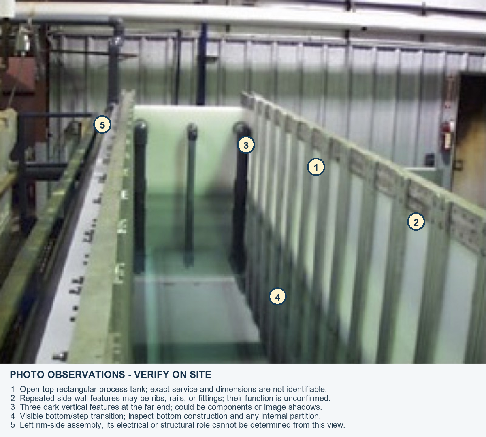
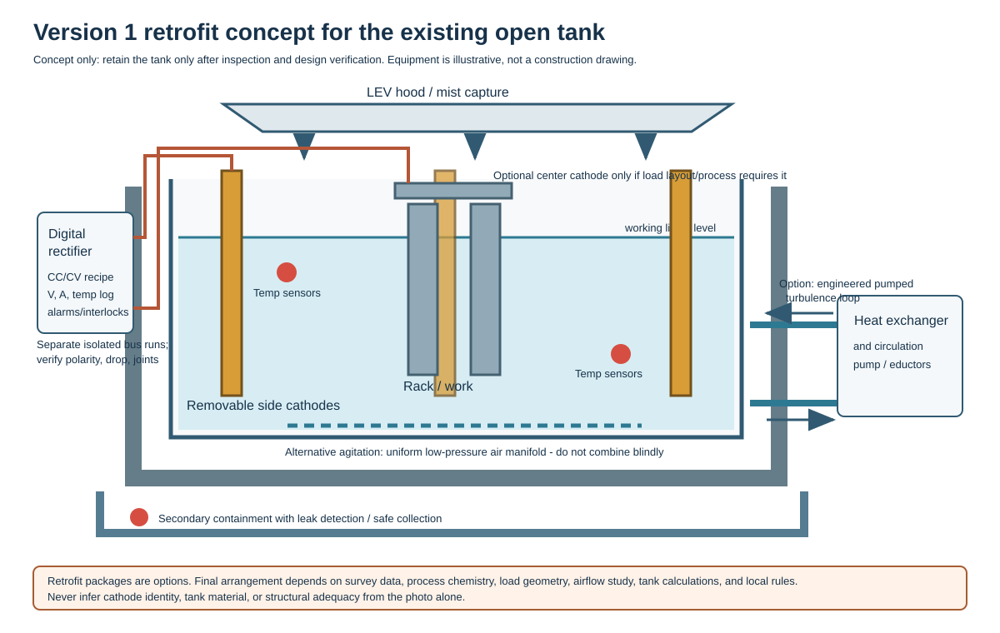

# Version 1 old anodizing tank assessment

**Prepared:** 20 November 2026  
**Basis:** user-supplied photo and the earlier cathode/tank discussion in this repository.

## Executive assessment

The photo shows a long, open-top rectangular process tank. It appears to have repeated features along the inner side walls, three dark vertical features near the far end, a visible bottom or internal step, and a rail/assembly along the left rim. Those details are visible; their materials and functions are not identifiable from this low-resolution single view.

Given the repository context, this may be an aluminum anodizing tank. The photo alone cannot confirm that process, bath chemistry, tank material, dimensions, cathode identity, leak condition, or structural integrity. Treat this as a **survey and modernization concept**, not a tank-condition diagnosis.

**Recommended path:** first inspect the tank, supports, liner/welds, electrical system, bath circulation, extraction, and secondary containment. If the vessel passes a competent condition assessment, preserve the tank shell and modernize the controls, cathode/rack system, heat transfer, monitoring, and environmental controls in phases. If the shell, lining, base, or supports fail the engineering review, replace or reline it using an engineered design.

## The supplied photo

[Open the original photo](original-photo.jpeg). Numbered notes deliberately avoid identifying ambiguous components as electrodes or defects.

## Retrofit concept image

This concept is one possible arrangement. It is not a drawing of the equipment in the photo and not a fabrication or electrical design.

## Priorities for the existing system

| Priority | Action | Why it matters |
| --- | --- | --- |
| Before continued operation | Verify tank and lining integrity, support loads, leak containment, electrical isolation, and safe access. | The photo cannot establish fitness for service. A failed liner or unsupported wall can have serious consequences. |
| First upgrade | Measure voltage/current at the tank, bath temperature at several positions, bus-joint temperature/drop, cooling duty, and agitation uniformity. | Creates a baseline and identifies whether the limiting issue is electrical, thermal, flow, or load arrangement. |
| Process consistency | Identify each visible internal component, map cathode/work positions, calculate active surface area, standardize rack spacing, and log batch recipes. | Supports repeatable current density, coating thickness, and traceability. |
| Resource use | Track electricity, water, acid additions, drag-out, effluent volume, and sludge per area or mass treated. | Makes energy, water, chemical, and wastewater projects comparable. |
| Modernization gate | Choose retrofit, reline, or replacement only after the survey and process targets are known. | Avoids spending on controls while the tank or fluid system remains the bottleneck. |

## Recommended deliverables before equipment procurement

1. Tank drawing with internal dimensions, working/freeboard levels, material/liner, wall/base construction, supports, welds, nozzles, and penetrations.
2. Process basis: chemistry and concentration range, maximum operating/upset temperature, specific gravity, recipe, throughput, part/rack envelope, rectifier rating, target coating, and quality limits.
3. Condition report: internal and external photos, bowing/deflection, cracks, seams, discoloration, leaks, support/frame condition, foundation, prior repairs, and inspection baseline.
4. Electrical and thermal survey: rectifier input/output, actual current and voltage profiles, bus/contact drop and temperature, bath temperature map at load, cooling capacity, flow, and agitation map.
5. EHS and environmental review: mist capture/airflow, guarding and access, containment, wastewater analysis, discharge route, chemical handling, and local permit requirements.
6. Options comparison with lifecycle cost, energy/water per production unit, expected downtime, validation plan, and acceptance criteria.

## Detailed method

See [technical assessment and modernization method](assessment-and-modernization.md) and the fillable [site survey checklist](site-survey-checklist.md).

## Limits

No dimensions, material grade, bath chemistry, current, temperature, flow rate, production target, defect history, or leak history were supplied. Do not use photo proportions to size the tank or cathodes. Have the tank maker, anodizing process engineer, electrical engineer, and EHS/environmental owner approve modifications in their disciplines.

## Reference material

- [QUALANOD Specifications, current edition dated 1 January 2026](https://www.qualanod.net/current-edition.html?file=files%2Fqualanod%2Fdownloads%2F2026-01-01+QUALANOD+Specifications.pdf) - anodizing tank capacity, cooling, agitation, current supply, bus contacts, jigs, and rinsing. These are qualification specifications; apply them where the relevant scheme/customer requirements call for them.
- [Aluminum Anodizers Council Technical Bulletin #1-00](https://cdn.ymaws.com/anodizing.site-ym.com/resource/resmgr/Docs/Technical_Bulletin_1-00_Sulf.pdf) - aluminum cathodes in sulfuric-acid anodizing.
- [EPA Ireland BAT Guidance for surface treatment of metals and plastics](https://www.epa.ie/publications/licensing--permitting/industrial/ied/BAT-Guidance-Note-for-Metals-%26-Plastics-Sector.pdf) - monitoring, water/energy use, process recovery, exhaust control, and wastewater options.
- [HSE PM86 thermoplastic tank integrity guidance](https://www.hse.gov.uk/pubns/guidance/pm86.pdf) - tank service limits, anchoring, inspection, and integrity baselining.
- [HSE G406 local exhaust ventilation guidance](https://www.hse.gov.uk/pubns/guidance/g406.pdf) - LEV design inputs, capture, airflow indication, and commissioning principles.
- The repository's [cathode fixing engineering report](../../reports/Cathode_Plate_Fixing_Engineering_Report.docx) and [PP tank construction guide](../../pp-tank/README.md).
