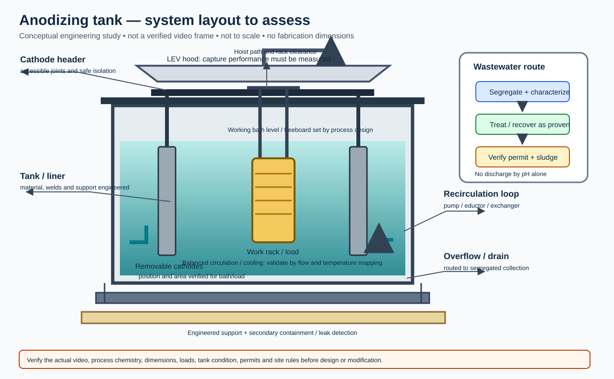

# Version 2 — Video-referenced tank setup and modernization guide

This case study organizes the supplied 44.96-second video, the earlier tank-photo case study, and the repository's existing design notes into a practical guide for assessing and planning an anodizing tank installation.

> **Video review status:** The source MP4 is included in this folder, but a frame decoder was not available in the current non-UI environment. The clip has **not** been visually reviewed frame by frame. Accordingly, this report does not claim that any pipe, electrode, heater, tank material, movement, or process sequence was identified in the video. Start with [`VIDEO-REVIEW.md`](VIDEO-REVIEW.md) to see what is and is not verified. The setup diagram below is a conceptual proposal, not a tracing of the clip.

## Files in this version

- [`REPORT.md`](REPORT.md) — engineering assessment, alternative solutions, implementation sequence, and information required for design.
- [`VIDEO-REVIEW.md`](VIDEO-REVIEW.md) — source details, accessible metadata, review limits, and a timestamped frame-review worksheet.
- [`setup-concept.svg`](setup-concept.svg) — original conceptual tank layout showing major systems to evaluate.
- [`source-video.mp4`](source-video.mp4) — user-provided source clip, preserved unchanged.
- [`../version-1/README.md`](../version-1/README.md) — separate assessment of the earlier still photograph; observations there are not attributed to this video.

## Quick guide to the proposed setup

The concept drawing separates five functions that must be designed together: a chemically compatible tank and structural support; cathode/header and work-rack current paths; cooling and uniform bath movement; mist capture and safe access; and segregated rinse/wastewater collection. Final positions, dimensions, materials, operating settings, and control logic must come from measured plant requirements and qualified design calculations.

## Explore alternatives

- Tank construction: [`../../pp-tank/construction-methods/`](../../pp-tank/construction-methods/README.md) — shop-welded, site-assembled, lined-shell, double-wall, ribbed, circular, or stock/molded options.
- Tank materials: [`../../pp-tank/alternatives/`](../../pp-tank/alternatives/README.md) — PP, PVDF, CPVC/PVC, HDPE, dual laminate, barrier FRP, lined structures, and stainless steel, each subject to compatibility review.
- Cathode installation: [`../../cathode-plate/methods/`](../../cathode-plate/methods/README.md) and [`../../cathode-plate/material-alternatives/`](../../cathode-plate/material-alternatives/README.md).
- Wastewater: [`../../wastewater/`](../../wastewater/README.md) — conventional precipitation, sludge dewatering, and acid recovery concepts.

## Intended use

Use this package to plan a site survey and develop a design brief. It is not a build-to-print package, operating procedure, permit assessment, or proof that the existing system is safe or defective. Get the clip's visual review log completed before making video-specific claims. Have a competent tank designer, anodizing process engineer, electrical engineer, ventilation engineer, and environmental/EHS staff review the relevant portions before procurement or modification.
