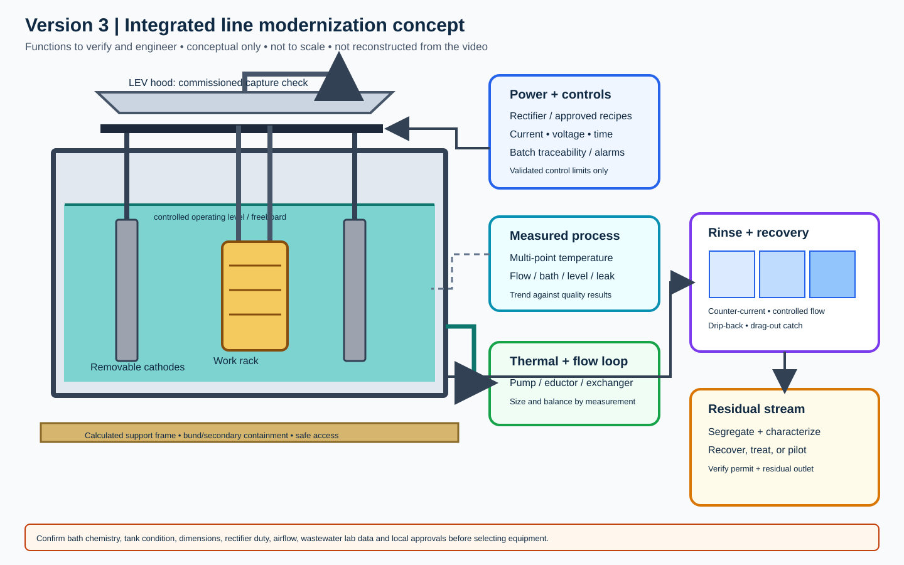
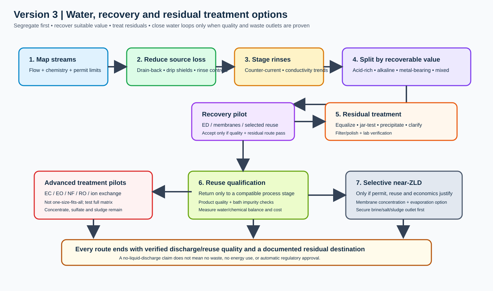

# Version 3 — International advanced modernization concepts

Version 3 extends the Version 1 still-photo assessment and Version 2 video-referenced study. It compares international methods relevant to a long anodizing tank, cathode and electrical layout, water use, acid recovery, and wastewater treatment.

> **Evidence boundary:** Version 1 contains observations from one low-resolution still. Version 2 preserves the supplied 44.96-second clip, but the clip was not decoded frame by frame. Version 3 cannot verify that the photo and clip depict the same line, identify process chemistry, or diagnose tank defects. Concepts are conditional on site survey and lab data.

## Read the package

- [Engineering report](REPORT.md) — evidence, international practice, technologies, recommended pathways, and validation gates.
- [Method comparison matrix](METHOD-COMPARISON.md) — relative fit, maturity, risks, cost drivers, and recommended gates.
- [Concept 1: engineered tank and modular cathodes](concepts/01-engineered-tank-and-cathodes/README.md)
- [Concept 2: digital power, process control, and traceability](concepts/02-digital-process-control/README.md)
- [Concept 3: rinse optimization and acid/water recovery](concepts/03-rinse-and-acid-recovery/README.md)
- [Concept 4: advanced wastewater treatment](concepts/04-advanced-wastewater/README.md)
- [Concept 5: selective near-zero liquid discharge](concepts/05-selective-zld/README.md)

## Original concept images

The visuals are original SVG diagrams so they remain crisp on GitHub and can be updated with verified dimensions later. They are conceptual, not fabrication drawings or video frames.

## How V3 relates to previous versions

| Version | Evidence and contribution | What it does not establish |
|---|---|---|
| [Version 1](../version-1/README.md) | Cautious observations from the provided tank photograph; inspection, retrofit, and survey framework. | Bath identity, material, defect status, actual cathode identity, dimensions, or successful LEV. |
| [Version 2](../version-2/README.md) | Adds the supplied video file, metadata, tank setup report, and a timestamped worksheet. | Clip scene content or a frame-by-frame sequence; review worksheet makes this explicit. |
| **Version 3** | Adds a source-ranked international technology comparison and a phased selection concept. | That a method is installed at this specific plant, universally best, permitted locally, or ready to build. |

## Scope

“International” means the report compares published European Union BAT references, U.S. EPA metal-finishing pollution-prevention guidance, and peer-reviewed aluminum-finishing case studies from Türkiye and other research groups. It does not rank countries or claim that one country's practice is automatically compliant or economical in India. Always use applicable Indian permits, consent conditions, hazardous-waste rules, occupational exposure requirements, and customer specifications for implementation.
