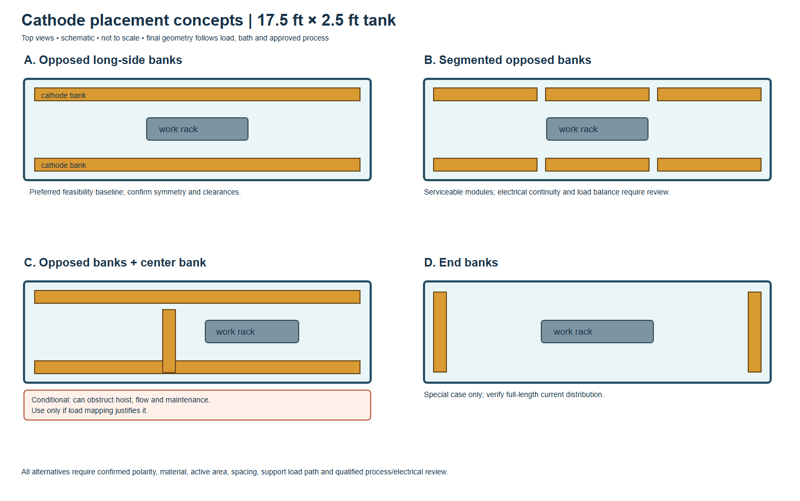
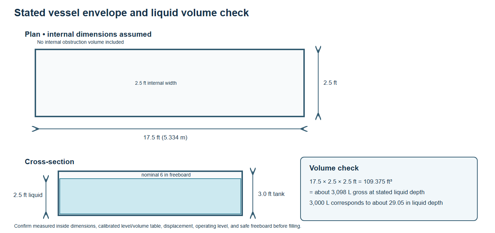
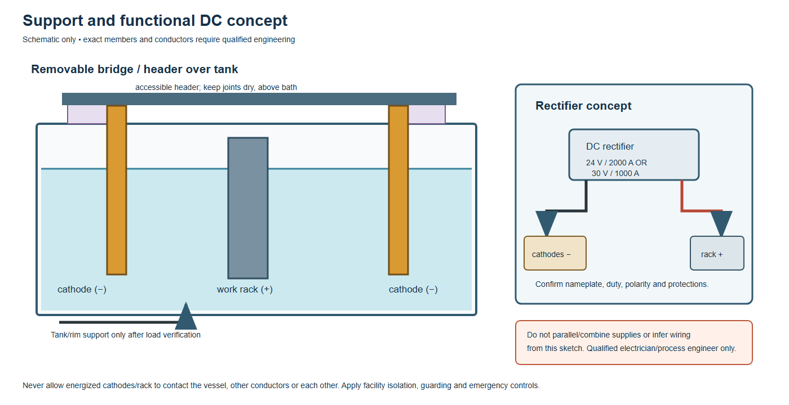

# Cathode Placement Design

## Purpose and recommendation

This package turns the repository's existing cathode-fixing guidance into a site-specific concept for a stated long tank: **17.5 ft internal length × 2.5 ft internal width × 2.5 ft normal liquid depth**, in a **3 ft deep vessel**, with either a **24 V / 2,000 A** or **30 V / 1,000 A** rectifier. The preferred concept for feasibility is **two removable cathode banks on the long sides, top-supported on an independently verified rim or frame, with the work rack centered**. Final plate count, area, spacing, cross-section, frame and bus sizing remain open pending process and equipment data.

The design inherits the repository's Version 1 survey uncertainty, Version 2 setup concept, Version 3 staged modernization gates, and the cathode fixing report. None proves the current bath chemistry, tank condition, load geometry or actual rectifier operating point. This folder is a feasibility package, not a fabrication, electrical installation or operating drawing.

## Given data and dimensional check

| Item | Stated basis | Engineering check |
|---|---:|---|
| Tank internal length | 17.5 ft (5.334 m) | Verify clear internal dimension after lining and fittings. |
| Tank internal width | 2.5 ft (0.762 m) | Verify usable rack/cathode envelope. |
| Liquid depth | 2.5 ft (0.762 m) | Normal level is assumed, not a measured operating level. |
| Tank depth | 3.0 ft (0.914 m) | Leaves nominal 6 in freeboard at 2.5 ft liquid depth. |
| Gross rectangular liquid volume at stated liquid depth | 109.375 ft³ = about **3,098 L** | Assumes the dimensions are internal, rectangular and unobstructed. It is about 98 L above the 3,000 L nominal target. |
| Liquid depth for 3,000 L | about **2.421 ft (29.05 in / 0.737 m)** | At this target level, nominal freeboard is about 6.95 in, before displacement and level-control allowance. |
| Rectifier A | 24 V × 2,000 A = **48 kW DC nameplate product** | Confirm continuous duty, output ripple, cooling, mains input, cable/bus ratings and actual process envelope. |
| Rectifier B | 30 V × 1,000 A = **30 kW DC nameplate product** | Same checks. It is not an additive rating with Rectifier A unless a qualified electrical/process design explicitly permits a coordinated configuration. |

The volume calculation does not include displacement by racks, work, cathodes, cooling coils or other internals. Confirm actual working capacity with a calibrated level/volume table. Rectifier maximum current is not a cathode-area design basis by itself: determine actual load area, approved current density, duty cycle and process recipe first.

## Placement concepts

The figure compares four arrangements to screen at feasibility. **Option A is the starting concept**, because opposed long-side banks support a centered work envelope and follow the repo's two-sided recommendation. Option B uses divided modular banks for service isolation and adjustment. Option C adds a center bank only if rack geometry/current-distribution mapping demonstrates the need; it can obstruct circulation and handling. Option D is an end-bank idea for process-specific small loads and is not the default for a long work zone. All are schematic and not to scale.

The plan marks the given envelope only. Actual plate height, length, count, gap and rack size are intentionally not assigned. The repository's cathode report cites a **250 mm minimum work-to-cathode gap** for sulfuric-acid aluminum anodizing from the AAC bulletin; verify that the bath and governing process specification are indeed applicable before using that value. Maintain clearance to all conductive hardware over the complete hoist/rack travel.

## Support and electrical architecture

Use a removable conductive header with insulated bearing saddles on tank-maker-approved points or an independently engineered bridge/frame. Keep bus joints above the liquid and shielded from mist and drips. Do not add wetted-wall penetrations as a retrofit. Engineer lifting features and verify wet mass, load path, lateral restraint, thermal movement, polymer creep, rim bearing, hoist clearance and secondary containment.

Show the rectifier negative connection to cathodes and positive connection to the work rack only after qualified staff confirm the plant polarity and process. Diagram is a functional polarity convention for sulfuric-acid anodizing, not permission to connect equipment. Provide correctly rated, guarded conductors, disconnect/isolation, overcurrent protection and emergency response under the facility electrical design. Never parallel or series-connect the two rectifiers based on these concept notes.

## Cathode materials and area logic

For conventional sulfuric-acid anodizing, the repository's fixing report and AAC bulletin identify aluminum cathodes as a common high-conductivity option; 6063 T5/T6 extrusion and 1100/1350 sheet are mentioned in the report, as is 5356 filler for aluminum welds. The same report notes the AAC bulletin's 3:1 anode-to-cathode active-area starting ratio and 5:1 for special cases, and a 250 mm work-to-cathode minimum. These are **process-specific references**, not a universal recipe. Process/customer approval controls. Lead, stainless and graphite are comparison alternatives in the existing material folders and require their own process, exposure, corrosion and contamination review.

Do not calculate plate count or dimensions from tank volume or rectifier nameplate alone. Use the facility's consistent definition of exposed active work area and approved current-density basis. The simple arithmetic envelope `I / J` only applies when `J` is a confirmed process current-density value and output current is the actual operating current; neither is supplied here. Derive active cathode area under the governing process method, then distribute symmetrically and validate on representative loads. Mask or shield unused areas only where an approved process trial supports it.

## Feasibility comparison

| Concept | Fit to this tank | Main benefit | Decision gate |
|---|---|---|---|
| A. Opposed long-side banks, removable top header | Preferred baseline | Symmetric work envelope, removable, accessible joints, no wall holes | Verify rim/frame and rack clearances; map current distribution. |
| B. Segmented opposed banks | Strong alternative | Modules can be inspected/removed independently and adjusted to load zones | Ensure electrically sound header connections and avoid inactive/unequal current zones. |
| C. Opposed banks plus center bank | Conditional only | May improve coverage for a wide/multi-rack load | Demonstrate need; check obstruction, shorting/contact risk, circulation and service clearance. |
| D. End banks | Special-case only | Can suit short work located away from long sides | Demonstrate uniformity for the complete load; likely poor fit for long work envelope. |
| Support: rim saddles | Preferred only if verified | Simple removable assembly | Tank maker/structural engineer confirms bearing, reinforcement and creep. |
| Support: independent frame | Preferred if rim unknown/weak | Moves loads to verified floor/building structure | Engineer stability, anchors, corrosion protection and electrical isolation. |
| Support: engineered integrated seats | New tank/rebuild | Coordinated vessel and bus geometry | Specify loads and isolation before tank fabrication. |
| Wall cleats or penetrations | Not the default | Can constrain a light plate in a purpose-designed vessel | Tank-fabricator detail, liner integrity, load and leak review required. |

## Required site data before engineering release

1. Confirm bath identity, composition/concentration, temperature range, contamination limits, work alloys and customer/process specification.
2. Measure internal tank dimensions, actual levels and capacity; identify tank material, supports, welds, wall movement, foundation and containment. Review the Version 1 site survey and Version 3 safety/integrity gate.
3. Record rectifier manufacturer/model, continuous-duty ratings, AC supply, output characteristic, polarity, protections, cable/bus details, cooling, calibration and current/voltage trends under representative loads for each unit.
4. Measure the largest rack/part envelope, work area per load, hanging/contact arrangement, load schedule, hoist path and required circulation/cooling clearances.
5. Confirm cathode material/area/position and map current distribution plus coating thickness/quality on representative loads. Record joint voltage drop and temperature using qualified methods.
6. Have the tank maker/competent structural engineer and plant electrical/process/EHS reviewers approve the support, isolation, extraction, lift, containment and commissioning plans.

## Commissioning evidence to collect

Only after approved drawings and site controls exist: verify empty-vessel/support alignment and isolation; conduct the tank maker's specified inspection; verify polarity and calibrated instrumentation; characterize voltage/current and joint temperatures at approved loads; map bath temperature; inspect coating quality/uniformity; and document alarms, isolation and maintenance. Acceptance limits belong to the process owner and qualified engineers.

## Sources within this repository

- [Cathode fixing engineering report](../../../reports/Cathode_Plate_Fixing_Engineering_Report.docx)
- [Cathode support method comparison](../../../cathode-plate/methods/README.md)
- [Cathode material alternatives](../../../cathode-plate/material-alternatives/README.md)
- [Version 1 tank assessment and site survey](../../version-1/README.md)
- [Version 2 setup report](../../version-2/REPORT.md)
- [Version 3 engineering report and design gates](../../version-3/REPORT.md)
- [PP tank construction and support guide](../../../pp-tank/README.md)
- [AAC Technical Bulletin #1-00](https://cdn.ymaws.com/anodizing.site-ym.com/resource/resmgr/Docs/Technical_Bulletin_1-00_Sulf.pdf)

## Status

Conceptual feasibility only. **Not for fabrication, wiring, procurement or operation.** No material thickness, plate count, bus section, support member size, cable size, current setpoint or safety setting is established. Those require measured site data and signed discipline reviews.
