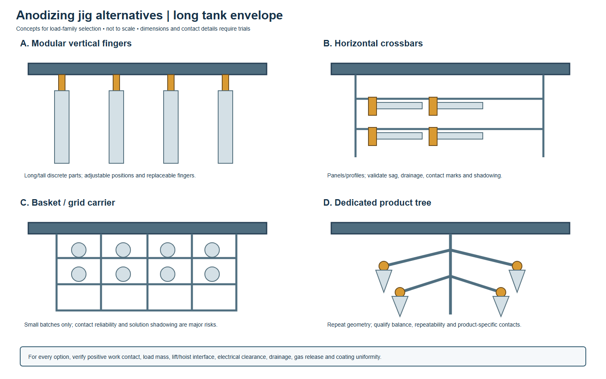
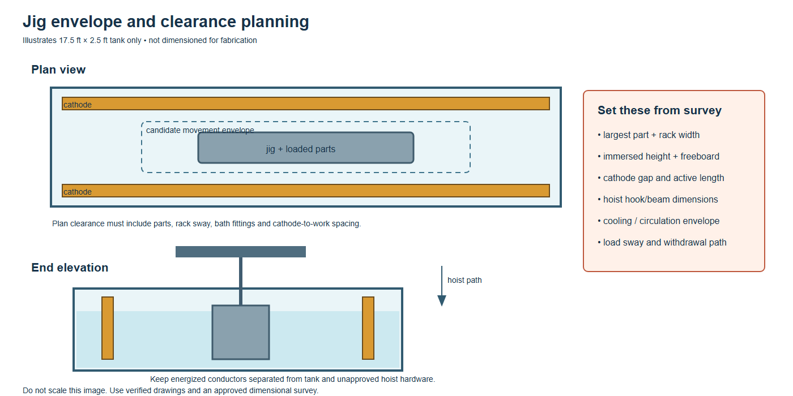
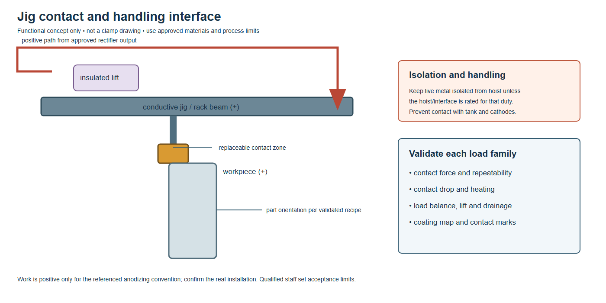

# Zig Design

## Interpretation and recommended concept

This package interprets **“zig” as the anodizing jig/rack or workpiece fixture** that carries parts as the anode. If “ZIG” means a different machine or local term, this package needs that meaning before detailed design. The feasibility concept is a **top-hung modular rack with an insulated handling beam, replaceable conductive contact fingers/clamps, and symmetric loading around the centerline**. The rack envelope must fit the specified 17.5 ft × 2.5 ft tank without contacting the cathodes, tank, coils or other conductive components.

The new drawings are options for review, not fabrication drawings. The supplied information does not include part geometry, alloy, load mass, exposed area, throughput, contact requirements, hoist dimensions or recipe. Therefore the number of parts, contact spacing, bar sections, material sizes and electrical ratings are not established.

## Design basis and electrical input

| Item | Input or derived value | Use in jig design |
|---|---|---|
| Tank | 17.5 ft (5.334 m) long × 2.5 ft (0.762 m) wide | Treat as stated internal dimensions pending survey; preserve cathode and hoist clearance. |
| Normal liquid depth / tank depth | 2.5 ft liquid / 3 ft vessel | Check immersed part height, drain-back, freeboard and beam elevation. |
| Nominal capacity | 3,000 L | Rectangular dimensions at stated depth calculate to about 3,098 L before displacement; validate actual level and volume. |
| Rectifier option A | 24 V / 2,000 A = 48 kW DC nameplate product | Verify process envelope and approved connection/contact current distribution. |
| Rectifier option B | 30 V / 1,000 A = 30 kW DC nameplate product | Separate alternative; do not treat as an additive capacity. |
| Work polarity | Work/rack is positive in sulfuric-acid anodizing | Confirm actual plant polarity by approved documentation and qualified safe checks. |

Voltage and current ratings alone do not establish the rack load capacity or contact count. Confirm actual process current, part surface area, approved current density, load mass, contact loss limits, duty cycle and supply protections with the process and electrical owners. Rectifier heat rejection, cabling, buswork and cooling belong to their respective qualified designs.

## Layout options

**Option A, modular vertical fingers**, is the starting point for tall individual parts where every part can be positively contacted and separated. **Option B, horizontal crossbars**, can suit flat panels or profiles if all parts drain and remain separated. **Option C, a multi-level basket/frame**, suits only small parts with a proven electrical contact strategy and adequate solution circulation; basket shadowing and poor contact can cause nonuniform coating. **Option D, a dedicated single-part tree**, can improve repeatability for complex parts but reduces flexibility. Select by part family and validated finish, not appearance alone.

The envelope drawing marks the tank and the nominal rack travel corridor without assigning final fixture dimensions. Define actual clearances from the cathode location, part envelope, hoist, tank fittings, circulation/cooling, and extraction equipment. Part spacing and arrangement require a process trial and must avoid part-to-part contact throughout loading, immersion and withdrawal.

## Mechanical and contact concept

The load path runs from parts through replaceable contact fingers/clamps to the conductive jig beam, then to a purpose-designed rack/header interface. A handling beam or insulator must keep energized metal away from the hoist unless the hoist and interface are designed for that electrical duty. Contact design must provide reproducible pressure and low resistance while limiting marks to approved, noncritical contact zones. Contacts need regular inspection and cleaning; no specific bolted or spring clamp detail should be fabricated until the process and materials are approved.

Key controls:

- Use material and finish compatible with the bath, temperature, contamination limits and work alloy; do not infer a preferred jig alloy from the tank material.
- Keep a positive, repeatable electrical path to each workpiece. Verify contact drop/temperature at representative current using approved limits.
- Prevent loose parts and conductive bridges between work, jig, cathodes, tank fittings and other circuits.
- Design for wet load weight, dynamic handling, lift points, balance, safe drainage and operator ergonomics; obtain hoist and structural approval.
- Check solution access, gas release, trapped-air pockets, masking/shadowing, drainage and withdrawal carryover for each part geometry.
- Provide traceable part family/load pattern and inspection criteria; do not automatically scale a validated rack pattern to new part families.

## Selection matrix

| Jig concept | Best fit | Benefits | Risks / validation |
|---|---|---|---|
| A. Modular vertical fingers | Long/tall discrete parts | Adjustable positions, easy inspection, flexible | Contact repeatability, part spacing, bending and current balance. |
| B. Horizontal crossbars | Flat sheets/extrusions | Simple loading and shared carrier | Part sag, contact marks, drainage, shadowing and rack clearance. |
| C. Basket/grid carrier | Small components | Batch handling and high piece count | Contact uncertainty, shielding, gas retention, uneven coating; pilot required. |
| D. Dedicated product tree | Repeating complex parts | Repeatable orientation and load definition | Low flexibility, tooling cost, wear and family-specific qualification. |

## Engineering release inputs

1. Part drawings, material/alloy/temper, surface area, maximum mass, critical finish zones and approved contact zones for each product family.
2. Load pattern, parts per batch, target coating/thickness/quality, cycle profile, approved current-density range and process/customer specification.
3. Confirmed bath chemistry/temperature and allowable jig-material contamination/corrosion limits.
4. Hoist rated capacity, beam interface, travel path, lifting points, dynamic factor and operator handling requirements.
5. Verified tank internal dimensions, cathode banks, rack-to-cathode gap, fittings, cooling and agitation, LEV capture, freeboard and bath level.
6. Rectifier model and actual output profile, polarity, calibrated current measurement, contact voltage drop, cabling/bus details, protection and isolation reviewed by qualified staff.
7. Trial plan and acceptance criteria for coating uniformity, thickness, contact marks, edge build, adhesion/corrosion/wear where relevant, and repeatability across the load.

## Validation sequence

Start with a single representative product family and a controlled fixture trial approved by the process owner. Record load geometry, contact positions, part spacing, actual current/voltage and time profile, bath temperature, contact observations and coating map. Change one layout variable at a time. Qualify new families separately. Release only after mechanical, process, electrical, EHS and quality owners approve the drawings and records.

## Repository basis

- [Version 1 survey checklist](../../version-1/site-survey-checklist.md) identifies required rack, contact, cathode and hoist measurements.
- [Version 3 engineering report](../../version-3/REPORT.md) recommends measured baselines, process qualification and staged discipline review.
- [Cathode fixing engineering report](../../../reports/Cathode_Plate_Fixing_Engineering_Report.docx) establishes the cathode/work polarity convention and separation considerations for sulfuric-acid anodizing.
- [Existing cathode support methods](../../../cathode-plate/methods/README.md) cover top support and clearance constraints.

## Status

Conceptual jig study only. **Not for fabrication, lifting, wiring or production use.** No member sections, contact force, clamp hardware, contact count, current setpoint, hoist load, or safety limit is specified. Obtain measured part/site data and qualified mechanical, process, electrical and EHS approval first.
