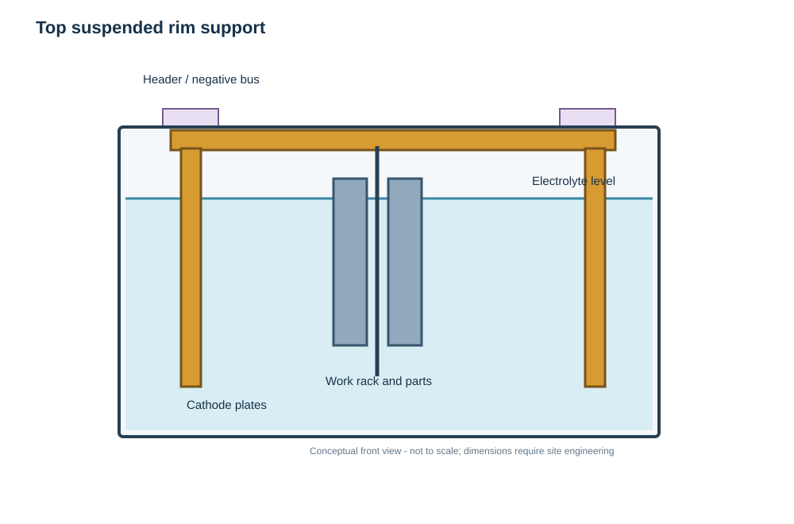

# Top suspended rim support

## Arrangement

The cathode plates attach to a conductive header bar. Electrically insulating saddles rest on verified tank-rim support points. The assembly lifts out as one unit.

## Construction sequence

1. Confirm tank rim capacity, reinforcement, bath level, rack envelope, and lift approach with the tank fabricator.
2. Set cathode plate length and spacing from the actual work envelope and required active cathode area.
3. Fabricate the header and cathodes using the approved material and joining procedure. For an aluminum sulfuric-acid system, consult the AAC bulletin for alloy, temper, and weld-filler requirements.
4. Fit replaceable acid-compatible insulating saddles between energized metal and the rim supports.
5. Keep the bus joint and welds above the electrolyte; check full rack and hoist clearance.
6. Verify spacing, current distribution, and joint temperature during commissioning.

## Advantages and limits

Removable, easy to inspect, and avoids a wetted-wall penetration. Suitable only if the tank rim and reinforcement can safely carry the assembly weight and operating loads. Polymer creep and local bearing pressure need review.

## Checks

See the root report. The schematic is conceptual and not dimensioned.
