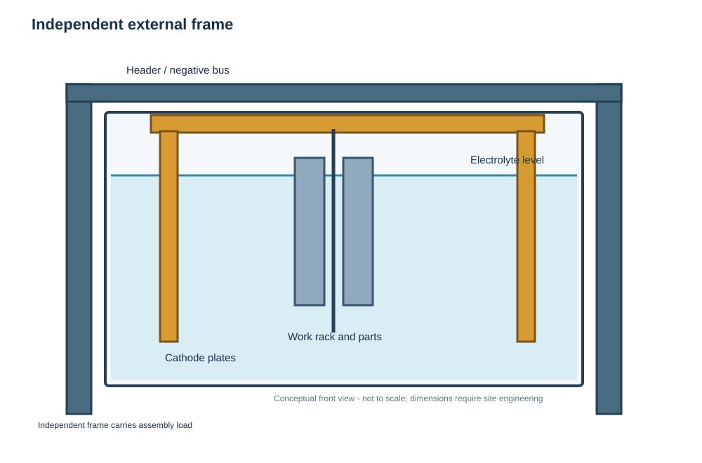

# Independent external frame

## Arrangement

A frame supported by the floor or a verified building structure carries the header and cathodes. The tank rim is not the primary load path.

## Construction sequence

1. Have a qualified engineer size the frame, base, lateral bracing, corrosion protection, and anchors for the wet assembly and handling loads.
2. Set frame position so the cathodes align with the work and remain clear of the tank liner, racks, heaters, and hoist.
3. Install insulated bus seats and retainers designed for the bath environment.
4. Attach the cathode plates to the header using a process-approved joining method.
5. Route electrical leads to protected connections above the bath and away from acid mist.
6. Check isolation, alignment, lifting access, and current distribution before production.

## Advantages and limits

Useful where rim capacity is uncertain or the cathodes are heavy. Requires floor or structural space and a properly engineered stable frame. Do not rely on an unbraced freestanding frame.
