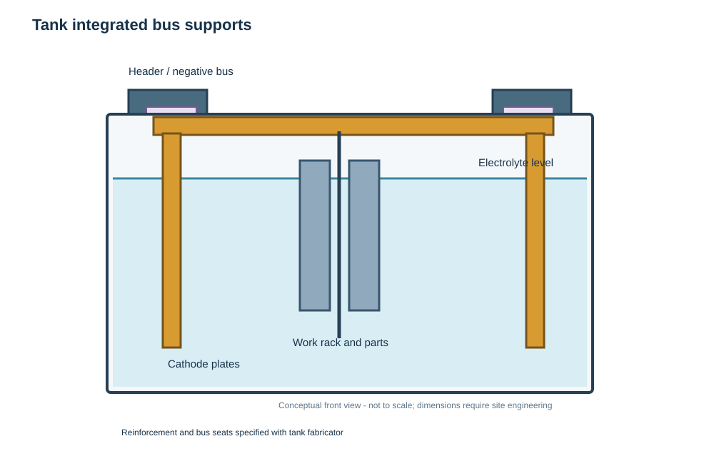

# Tank integrated bus supports

## Arrangement

The tank supplier incorporates reinforced seats, bus-bar locations, and electrical isolation details into the tank design. This is most practical for new tanks or major rebuilds.

## Construction sequence

1. Give the fabricator the tank dimensions, cathode area and location, process chemistry, maximum operating temperature, electrical load, and required clearances.
2. Agree on reinforcement and support loads; confirm PP grade, lining construction, creep allowance, and compatible insulating materials.
3. Specify replaceable support pieces and access for cleaning and inspection.
4. Review the fabrication drawing before release and check that supports cannot trap liquid or obstruct the rack/hoist path.
5. Inspect liner integrity and verify electrical isolation and alignment after installation.

## Advantages and limits

Clean integration with the tank and fewer retrofit brackets. The design is tank-specific and must be approved by the tank manufacturer; these sketches do not establish allowable loads.
