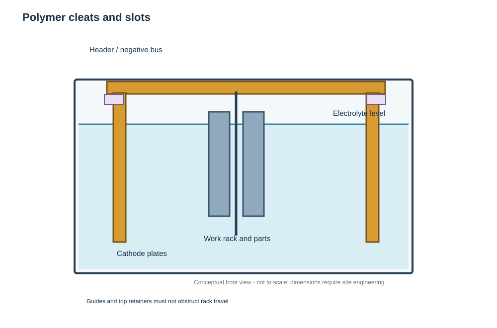

# Polymer cleats and slots

## Arrangement

Polymer guides retain the edges of removable plates. A top retainer prevents uplift and vibration. The guides should transfer loads to engineered reinforcement or a separate support, not unsupported thin PP wall alone.

## Construction sequence

1. Confirm chemical compatibility and temperature rating for the exact PP, PVC, PVDF, or other candidate polymer grade.
2. Have the tank fabricator check local wall stress, creep, reinforcement, and attachment method.
3. Provide clearance for plate removal, cleaning, thermal movement, and rack travel.
4. Add a nonconductive top retainer and verify the plate cannot contact the work or other metalwork.
5. Inspect the cleats regularly for wear, cracking, deformation, or looseness.

## Advantages and limits

Simple and modular for light plates. Material compatibility alone does not prove structural suitability. Avoid drilled wetted-wall fixings unless the tank fabricator designs the penetration and sealing system.
