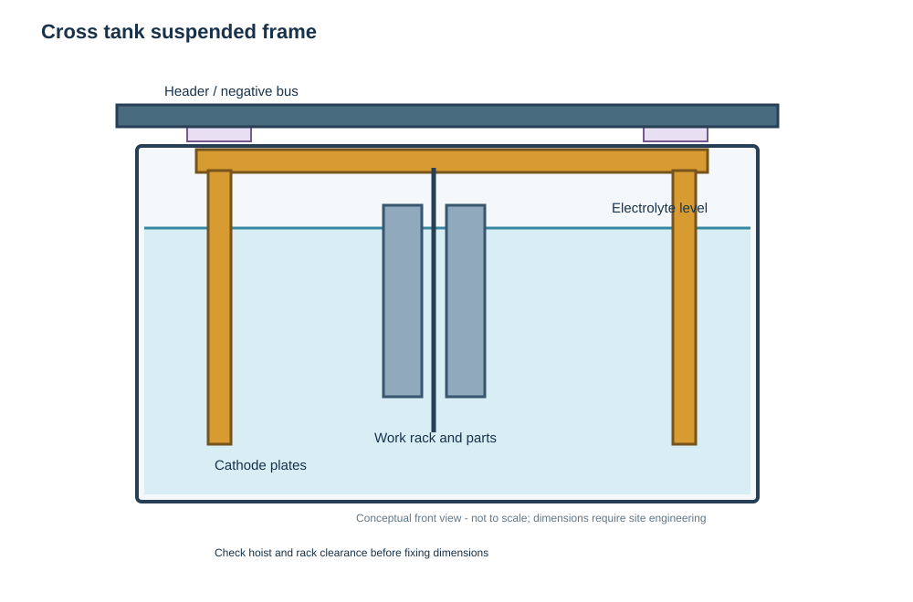

# Cross tank suspended frame

## Arrangement

A removable bridge spans the tank opening and supports the cathodes. Insulated bearing pads sit on verified rim points; the frame lifts out for service.

## Construction sequence

1. Check tank rim capacity, bridge span, bending, torsion, and handling loads with the tank fabricator or engineer.
2. Position the bridge outside the crane and rack travel envelope.
3. Install insulated pads and positive retainers so the frame cannot slide into the bath.
4. Hang the cathodes from the conductive header and keep electrical joints above the liquid.
5. Verify clearances across the full rack and hoist motion before energizing.

## Advantages and limits

Useful as a retrofit when side-wall attachment is undesirable. The bridge can obstruct overhead handling and concentrates load at a few rim points; engineering review is essential.
