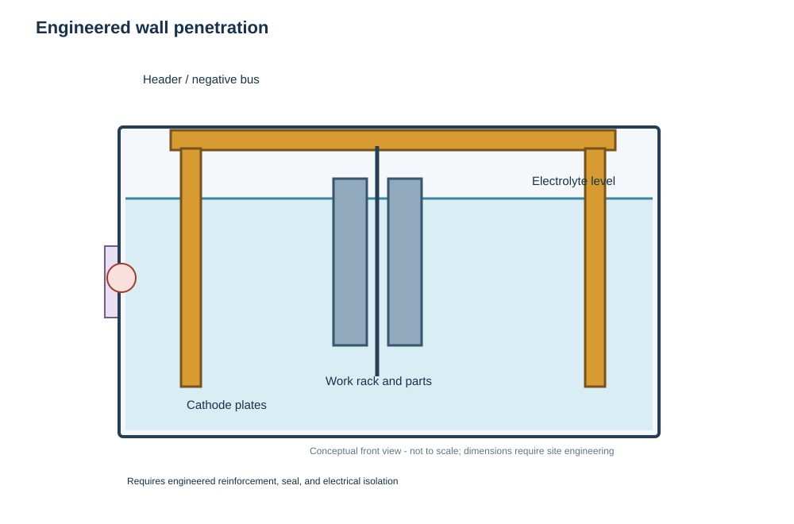

# Wall penetrating support

## Status

This is shown as a comparison option, not the recommended retrofit. Penetrations through a wetted PP wall introduce leak paths and local structural stress.

## If a penetration is unavoidable

Only proceed if the tank manufacturer or qualified fabricator supplies an engineered, reinforced, chemically compatible, sealed detail. The design must preserve liner integrity, isolate the energized assembly, prevent crevice trapping, and allow inspection. Do not field-drill and seal a production tank as an improvised support.

## Alternatives to consider first

Use top-rim saddles, an independent support frame, a purpose-built integrated bus support, or a cross-tank bridge. Compare these methods in the neighboring folders.
