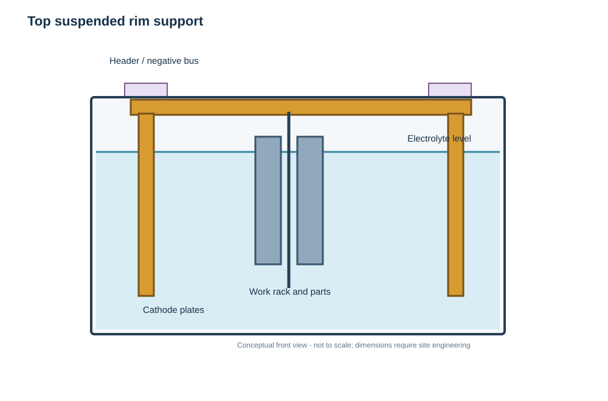
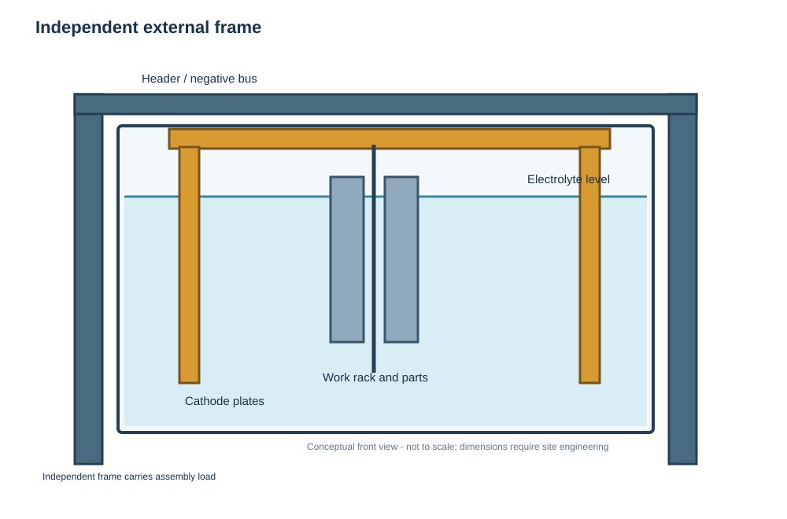
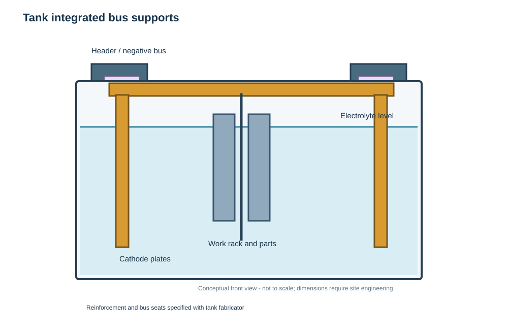
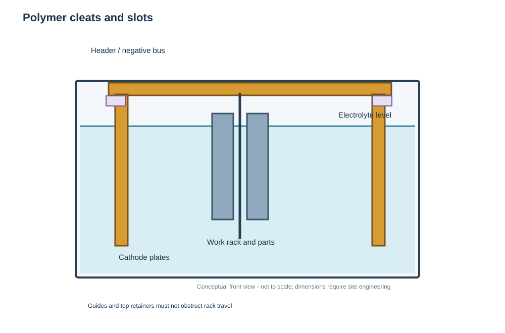
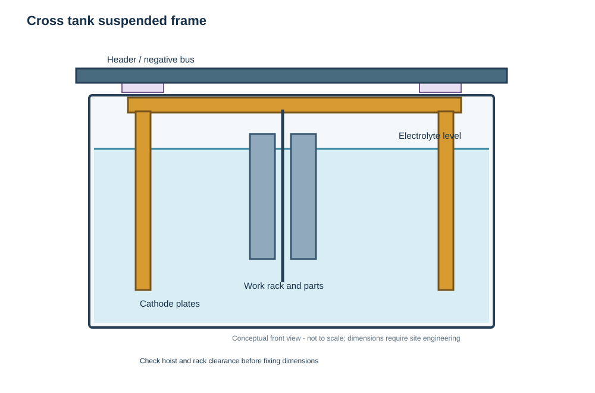
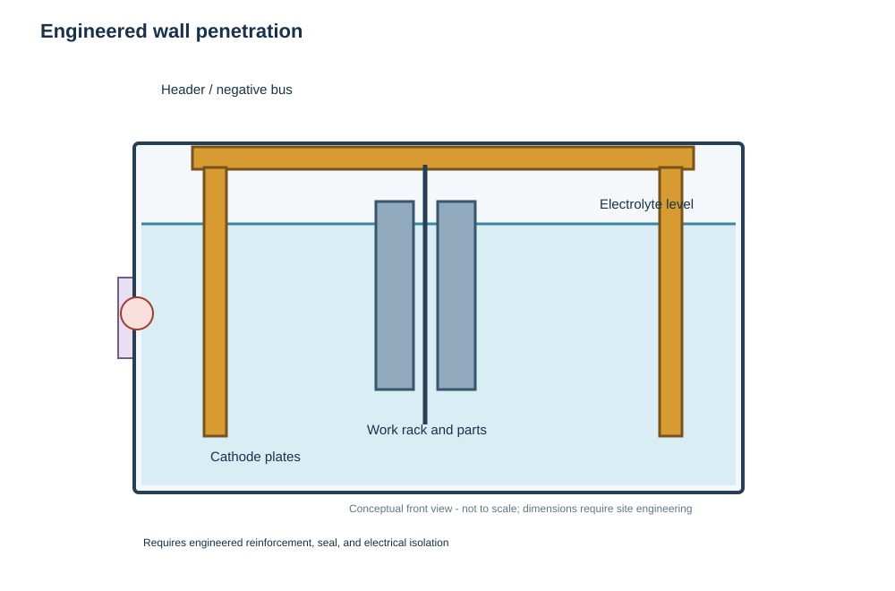

# Cathode support methods

The drawings below show conceptual front views of support arrangements for cathodes in a PP sulfuric-acid anodizing tank. They are not scaled fabrication drawings. Review each method folder for construction sequence, advantages, limitations, and required checks.

## 1. Top suspended rim support

Removable assembly on insulated saddles. Preferred starting point where tank-rim capacity is confirmed.

## 2. Independent external frame

Moves the main load to a separately engineered floor or structural frame.

## 3. Tank integrated bus supports

Tank-fabricator-designed reinforcement and bus seats, most suitable during new tank procurement.

## 4. Polymer cleats and slots

Simple retainers for light plates, subject to material, creep, local wall stress, and support checks.

## 5. Cross tank suspended frame

Removable bridge support; confirm it clears the rack and hoist envelope.

## 6. Wall penetrating support

Shown for comparison only. Avoid as an improvised retrofit because wall penetrations create leak paths. Use only a tank-fabricator-engineered sealed detail.
