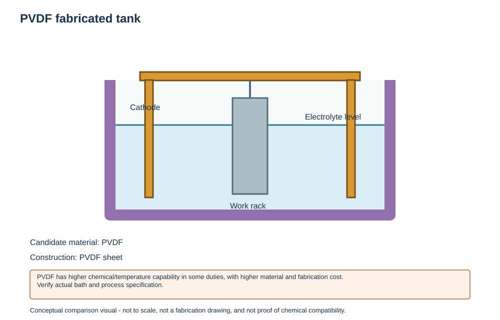

# PVDF fabricated tank

## Where it may fit

PVDF is a high-performance thermoplastic alternative when a PP tank does not meet the documented chemical or temperature duty. It can be fabricated as a complete vessel or used as a liner, depending on the tank supplier's design.

## Trade-offs and checks

PVDF usually carries a material and fabrication cost premium. Confirm the exact resin grade and welding system, long-term allowable stress, thermal expansion, support design, and compatibility with the complete bath recipe, including contamination and cleaning solutions. Require the tank supplier to approve the design basis in writing.

**Do not infer:** that PVDF is automatically compatible with every concentration, temperature, or anodizing additive.
