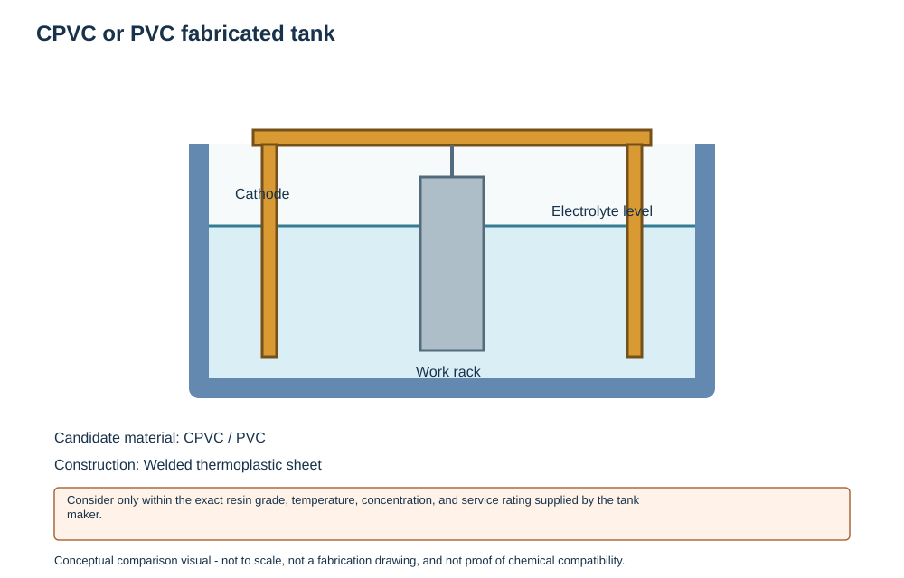

# CPVC or PVC fabricated tank

## Where it may fit

PVC or CPVC sheet tanks are used in some chemical and surface-finishing duties. They may be considered if the exact product grade and fabrication design are rated for the bath temperature and chemistry.

## Trade-offs and checks

Temperature capability, impact behavior, creep, weldability, and long-term strength vary with grade and design. Obtain written compatibility data for the actual solution, concentration range, operating/upset temperature, and planned life. Confirm the supplier's allowable stress and fabrication procedure.

Do not choose by a generic plastic chart or by a room-temperature acid rating alone.
