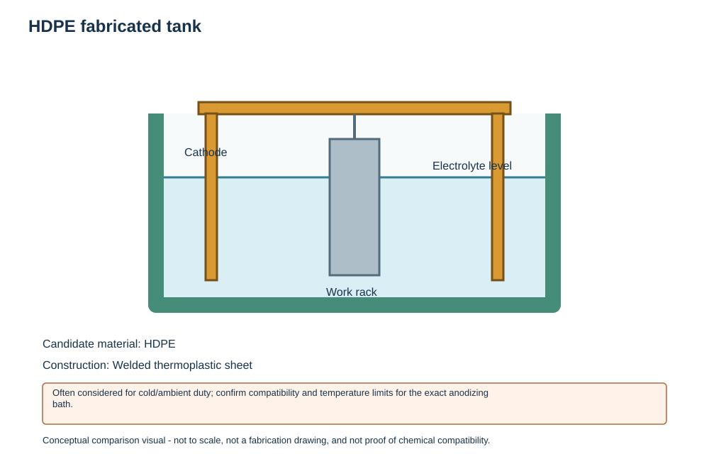

# HDPE fabricated tank

## Where it may fit

HDPE may be considered for cold or ambient processes where the exact material is compatible. Some tank suppliers use HDPE for lower-temperature or impact-sensitive duties.

## Trade-offs and checks

Confirm the specific grade, bath chemistry, temperature profile, stiffness, thermal expansion, support spacing, and long-term deflection. Do not infer suitability for a heated sulfuric-acid bath from an HDPE storage tank or a chemical-resistance chart.

The anodizing process designer and tank manufacturer should approve both chemistry and structural duty.
