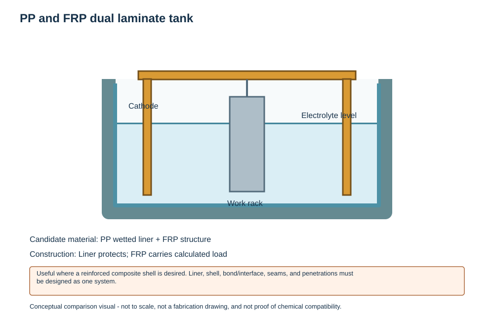

# PP and FRP dual laminate tank

## Concept

A thermoplastic PP layer provides the wetted corrosion barrier while a fiber-reinforced plastic (FRP) shell provides structural strength. The laminate system may be shop fabricated or assembled to suit tank size and access.

## Trade-offs and checks

Design the liner, shell, bond/interface, nozzle transitions, seams, and thermal expansion as one system. Confirm how the liner is supported, how leaks behind it are detected, and how the laminate and liner repairs will be inspected. Ensure the liner resin is compatible with the exact process bath.

This is not the same as placing a loose PP sheet inside a shell; restraint and details require a dual-laminate tank specialist.
