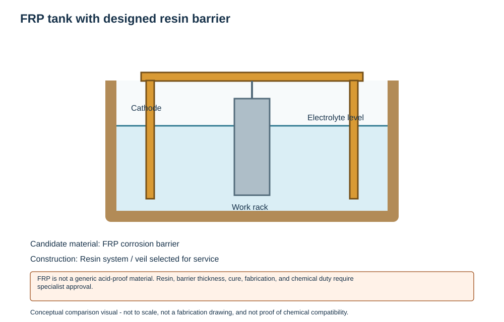

# FRP tank with a designed chemical barrier

## Concept

FRP can provide structural strength when the resin system and corrosion barrier are selected for the actual chemical service. The wetted barrier may use a resin-rich layer, veil, or a compatible thermoplastic liner according to the engineered design.

## Trade-offs and checks

“FRP” alone does not specify chemical resistance. The tank engineer must identify resin chemistry, reinforcement, corrosion barrier, cure, allowable temperature, and long-term design basis. Verify the entire bath and cleaning cycle with the resin supplier and tank fabricator.

Use a specialist's written design and inspection plan. Do not treat a generic fiberglass tank as suitable for anodizing acid.
