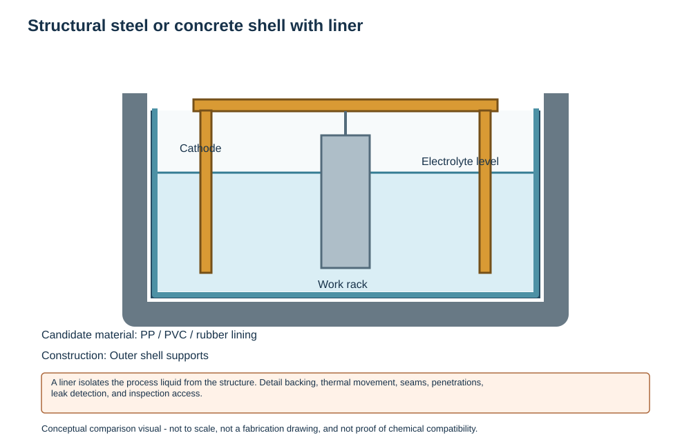

# Steel or concrete shell with a chemical-resistant liner

## Concept

A structural shell or existing pit carries the load; a thermoplastic or rubber lining isolates it from the process liquid. Candidate lining materials include PP, PVC/CPVC, PVDF, and selected rubber systems, subject to supplier approval.

## Trade-offs and checks

Specify continuous support behind the liner, corner and floor details, thermal movement, seams, nozzles, penetrations, and inspection. Provide leak detection where liquid could collect unseen behind the liner. Review repair access and inspect the substrate for corrosion or concrete damage.

Use a lining system designed for immersion and the exact bath, not a coating product intended only for splash or secondary containment.
