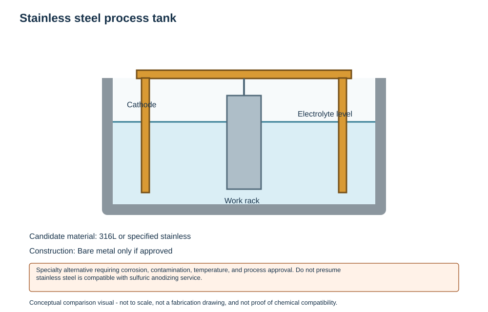

# Stainless steel process tank

## Where it may fit

Stainless steel is an alternative only when the process owner and materials engineer confirm its use for the exact anodizing chemistry and contamination limits. It may be considered in specialty installations or as a structural shell for a compatible liner.

## Trade-offs and checks

Do not presume a stainless grade is immune to sulfuric-acid attack. Confirm corrosion behavior at every process and upset condition, contamination tolerance, weld/passivation requirements, and how the vessel is electrically isolated from cathodes and bus bars. Review galvanic and stray-current paths.

An unlined stainless process tank is not the default recommendation in this guide. A stainless structural shell with a separately engineered PP/PVDF liner is a distinct option; see the lined-shell guide.
