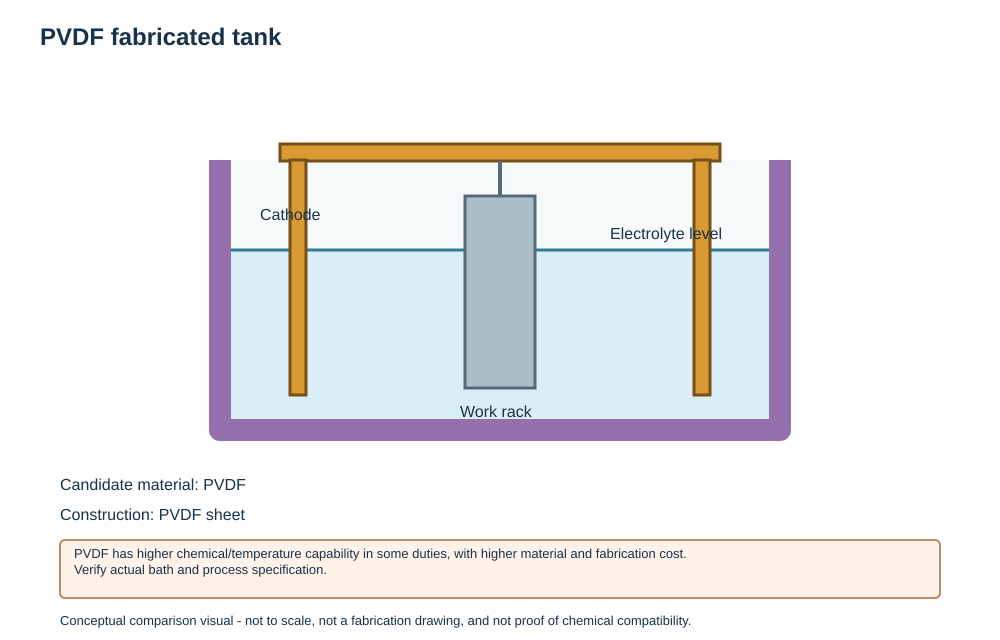

# Alternative tank materials and containment systems

Each option has a folder with a conceptual SVG and a short decision guide. These are candidate alternatives, not a ranking of chemical resistance. Final selection depends on the exact anodizing bath, impurities/additives, operating and upset temperatures, expected life, structural design, and process specification.

## Material alternatives

| Option | Summary | Folder |
| --- | --- | --- |
| PVDF fabricated tank | High-performance thermoplastic option for duties where PP is unsuitable; typically higher cost. | [01 PVDF](01-pvdf-tank/README.md) |
| CPVC or PVC tank | Candidate for selected corrosive duties and temperatures within the exact supplier rating. | [02 CPVC/PVC](02-cpvc-pvc-tank/README.md) |
| HDPE tank | Candidate for compatible ambient or lower-temperature processes; check stiffness and heat limits. | [03 HDPE](03-hdpe-tank/README.md) |
| PP/FRP dual laminate | PP provides the wetted barrier and FRP provides structural reinforcement. | [04 PP/FRP](04-dual-laminate-pp-frp/README.md) |
| FRP with chemical barrier | Resin and corrosion-barrier design selected specifically for the bath. | [05 FRP barrier](05-frp-chemical-barrier/README.md) |
| Lined steel or concrete shell | Structural shell supports a compatible replaceable or bonded liner. | [06 lined shell](06-lined-steel-or-concrete/README.md) |
| Stainless steel tank | Specialty option only with process owner approval and documented corrosion/contamination suitability. | [07 stainless steel](07-stainless-steel-tank/README.md) |

## Other setup alternatives already documented

- Tank architectures: [shop-welded, site-assembled, lined shell, double wall, ribbed, circular, and stock/molded](../construction-methods/README.md).
- PP tank welding approaches: [extrusion, hot gas, and heated-tool butt welding](../welding-methods/README.md).
- Cathode material alternatives: [aluminum, lead, stainless steel, and graphite](../../cathode-plate/material-alternatives/README.md).
- Cathode mounting alternatives: [six support/fixing arrangements](../../cathode-plate/methods/README.md).
- Secondary containment: a bund or double-wall arrangement must be sized and monitored per the risk and local rules. The [HSE tank integrity guide](https://www.hse.gov.uk/pubns/guidance/pm86.pdf) discusses design, anchoring, inspection, and integrity management.

The drawing shows the process tank as a generic vessel and highlights the candidate wetted material. It is not a compatibility certificate or construction plan.

## References

- [Protank surface-finishing tanks](https://www.protank.com/custom-plating-anodizing-tanks) lists fabricated options including PP, PVC/CPVC, HDPE, FRP, and PVDF and describes matching tank material to process conditions.
- [Palm Technology process tanks](https://www.palmequipment.com/index.cfm?FuseAction=ProcessEquipment_Tanks) describes thermoplastic tank materials used for surface finishing.
- [AB Plastics chemical tanks](https://www.ab-plastics.com/tanks.htm) lists thermoplastic, FRP, and dual-laminate configurations for corrosive service.
- [HSE PM86](https://www.hse.gov.uk/pubns/guidance/pm86.pdf) covers thermoplastic tank integrity, service limits, anchoring, and inspections.
