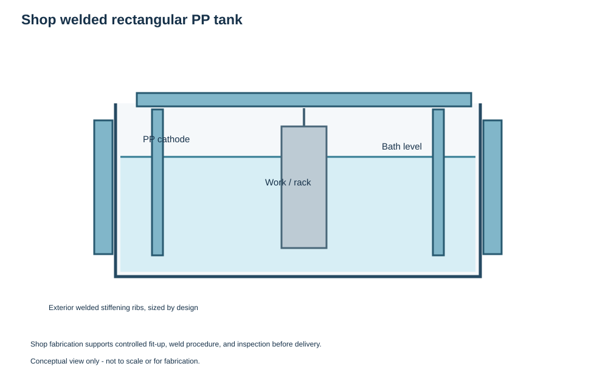

# Shop welded rectangular PP tank

## Concept

Cut PP sheet panels are assembled and welded in a controlled shop into a rectangular open-top tank. The shop can fixture the panels, control joint preparation, add nozzles and supports, and inspect the tank before shipment. External ribs or a structural frame may be part of the design.

## High-level build sequence

1. Develop the service design basis and calculation package with the thermoplastic tank designer.
2. Select traceable PP grade and sheet stock suitable for the solution, temperature, and long-term load.
3. CNC or accurately cut, square, and prepare the panels to the approved drawings.
4. Fixture base and walls; sequence approved butt-fusion, extrusion, and/or hot-gas welds per the weld map.
5. Add calculated ribs/frame, reinforced lifting/handling provisions, nozzles, overflow, drain, and cathode/rack support locations.
6. Inspect dimensions and welds; perform the designer-approved water-fill/leak test; document repairs and final acceptance.

## Fit for anodizing

Usually the most adaptable architecture for rectangular process baths and long parts. Include freeboard, rack immersion depth, cathode clearance, hoist path, ventilation, circulation, cooling/heating hardware, and access for cleaning in the design.

## Limits and design checks

Flat-wall deflection, base support, thermal expansion, creep, weld factors, nozzle loads, and support loads must be calculated. Shop-built does not mean self-supporting unless the approved design says so. Do not use the illustration to infer thickness or reinforcement spacing.
