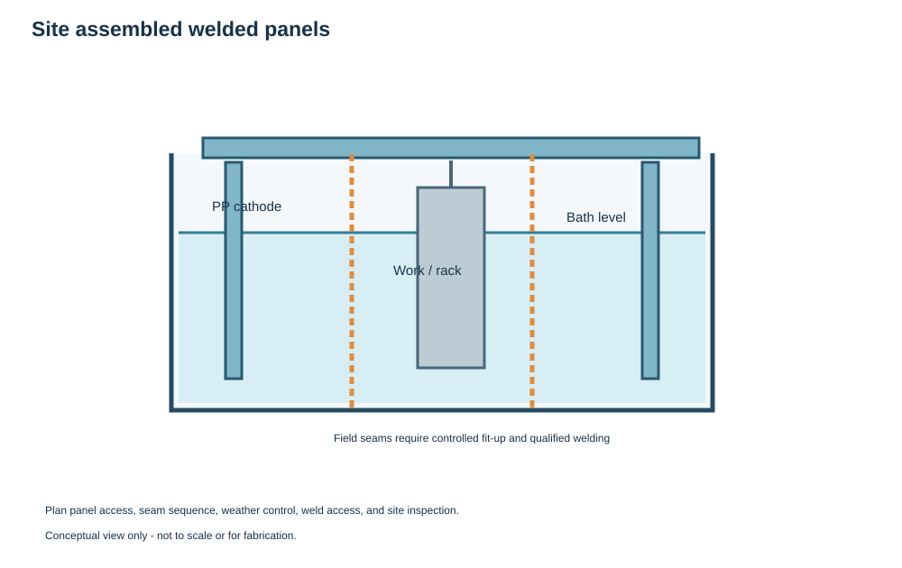

# Site assembled welded panels

## Concept

Panels or subassemblies are transported separately and joined at the installation location. This can solve access or transport constraints for long production tanks.

## High-level build sequence

1. Confirm that site assembly is allowed by the design standard, engineering package, warranty, and fabricator's quality plan.
2. Plan panel sizes, lifting routes, access, power, ventilation, cleanliness, weather protection, and fire precautions for welding equipment.
3. Prepare a level, engineered foundation and stage panels without twisting or damaging edges.
4. Fixture panels and complete each field seam using the qualified procedure and welder required by the design.
5. Record seam identity, welder, procedure, inspection, and any repair; protect completed seams during subsequent work.
6. Perform the specified leak test after cure/cooling and before installing sensitive equipment.

## Fit and limitations

Useful when an integral tank cannot pass through doors or be shipped. Field welding increases quality-control demands. Plan for all-side access and keep the installation environment within the qualified welding procedure limits. Do not rely on a field patch to replace structural design.
