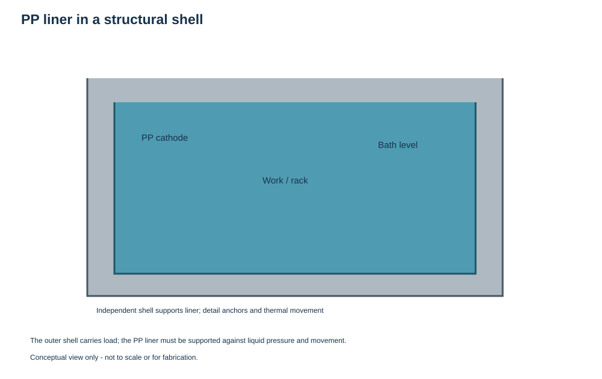

# PP liner in a structural shell

## Concept

A steel or concrete outer shell carries the hydrostatic and structural load. A PP liner provides the wetted surface. The lining may be shop-fabricated and installed or welded in place, depending on geometry and qualified supplier practice.

## High-level build sequence

1. Design the shell, foundation, liner, and interfaces as one system.
2. Verify the liner is continuously supported against liquid pressure, including at corners, floor, nozzles, and transitions.
3. Detail anchors, restraint, thermal movement, weld access, and how liquid behind the liner is prevented or detected.
4. Install/assemble the liner without sharp edges, trapped debris, or unreviewed penetrations.
5. Inspect seams and terminations; test the shell/liner system using the approved method before service.

## Fit and limitations

Can be useful for heavy-duty tanks and retrofits where a shell already exists. The PP lining must not be treated as a self-supporting vessel unless designed for that purpose. Differential expansion, liner buckling, hidden leaks, and inaccessible corrosion on the shell side require explicit design treatment.
