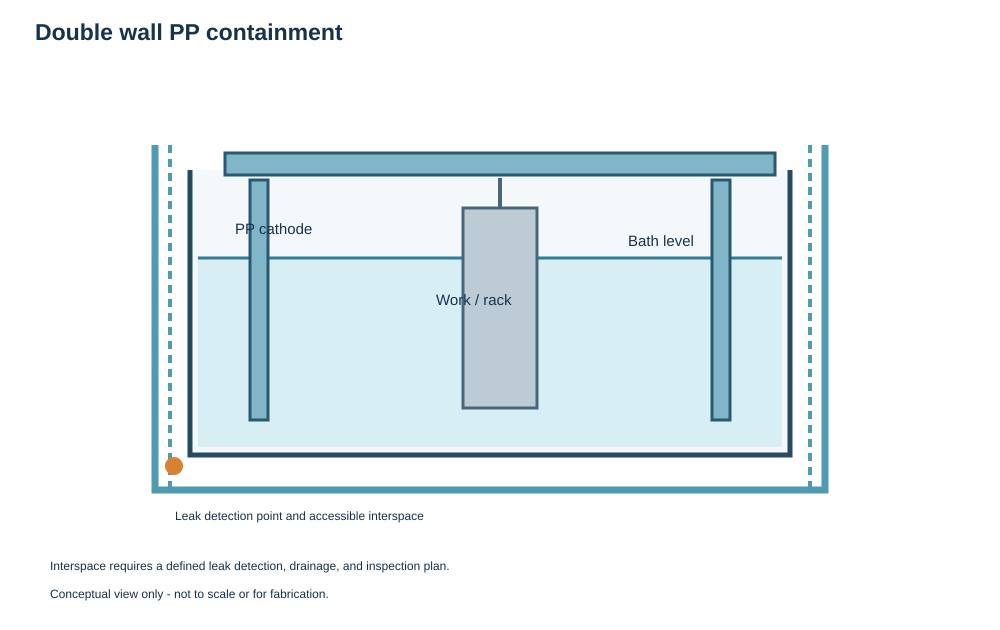

# Double wall PP containment

## Concept

A primary tank is surrounded by a secondary wall or bund. The interspace is intended to contain a leak and may include a sensor or inspection port. It is secondary containment, not a substitute for a properly designed primary tank.

## High-level build sequence

1. Define the required containment volume and local regulatory requirements.
2. Design primary and secondary shells, supports, access, interspace drainage, and leak detection together.
3. Ensure the interspace is visible/inspectable or instrumented and that sensor materials suit the environment.
4. Provide separate means to inspect each barrier and safely collect any leak.
5. Test primary vessel and secondary containment separately using the approved procedure.

## Fit and limitations

Useful where a release has high consequence or secondary containment is required. A sealed void without monitoring can hide a leak. Avoid inaccessible pockets and do not allow leak collection to compromise the building drain or environment.
