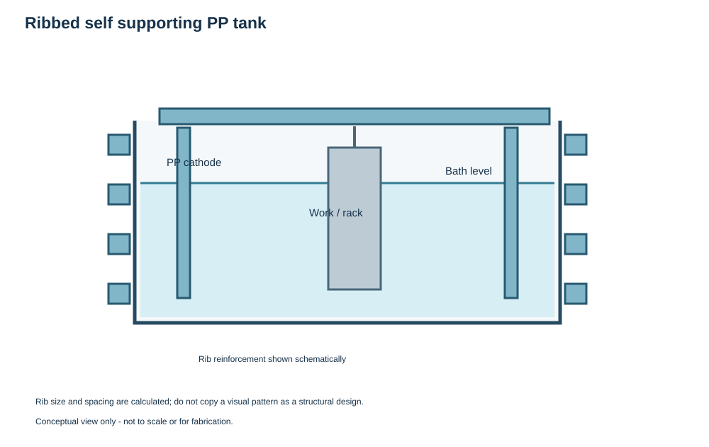

# Ribbed self supporting PP tank

## Concept

Welded PP ribs, an external steel frame, or a combination reinforce the flat walls. The vessel may be self-supporting only where the design calculations explicitly establish this.

## High-level build sequence

1. Calculate wall and base stresses/deflections for the hydrostatic load, temperature, time, liquid density, and design life.
2. Select a reinforcement architecture and model load transfer through ribs, welds, corners, base, and foundation.
3. Detail clearances for cleaning and inspectability; avoid crevices where chemicals can remain trapped.
4. Fabricate and attach reinforcement according to the approved weld map and sequence.
5. Verify reinforcement alignment, weld quality, support contact, and vessel deflection during the specified fill test.

## Fit and limitations

Useful for wide rectangular tanks where wall stiffness is an issue. More ribs are not automatically safer; reinforcement can create high local stresses, thermal restraints, or uninspectable joints. Obtain calculated spacing and section sizes from the tank designer.
