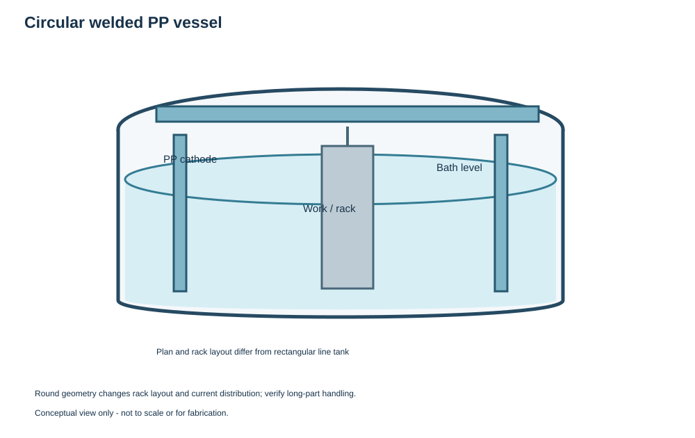

# Circular welded PP vessel

## Concept

A cylindrical PP vessel is built from formed or rolled sheet, a longitudinal shell seam, and welded end/bottom details. Engineering and applicable standards differ from a flat-sided rectangular process tank.

## High-level build sequence

1. Define whether the vessel is a process bath or storage tank; do not repurpose a pressure-rated or storage design without process review.
2. Design shell, base, supports, nozzles, freeboard, cathode geometry, and rack access for the circular layout.
3. Roll and join the shell with qualified procedures; join bottom and fittings per the approved detail.
4. Add secondary support and lifting provisions only as engineered.
5. Inspect the shell seam and test before service.

## Fit and limitations

Can work for compact processes or where round geometry is deliberate. Rectangular tanks often provide better use of floor space and clearance for long anodizing loads. Confirm current distribution and avoid assuming the same cathode layout as a rectangular tank.
