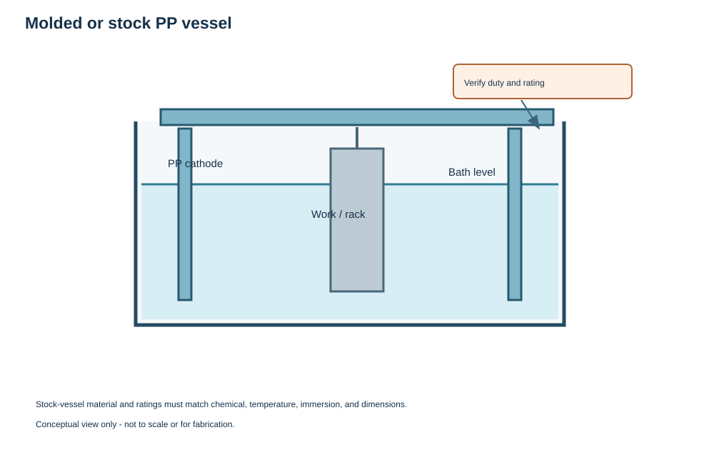

# Molded or stock PP vessel

## Concept

An off-the-shelf or molded PP vessel reduces custom fabrication only when a suitable product exists. In industrial rectangular PP process tanks, welded sheet construction is common; molded options are constrained by tooling, dimensions, geometry, and available ratings.

## Selection sequence

1. Obtain the exact manufacturer's material, dimensional, temperature, chemical, and structural rating documents.
2. Confirm that the largest part/rack, cathode plates, heating/cooling, agitation, ventilation, and maintenance access fit.
3. Confirm supports, penetrations, and any modifications are permitted by the product manufacturer.
4. Check chemical resistance under the actual concentration and temperature, not a generic PP chart alone.
5. Commission only after design review and a suitable leak/functional inspection.

## Fit and limitations

May fit small or standard processes. Do not assume domestic water tanks or generic tubs are suitable for hot acid immersion, process current, prolonged service, or industrial rack loads. Do not cut or weld a stock tank without manufacturer approval.
