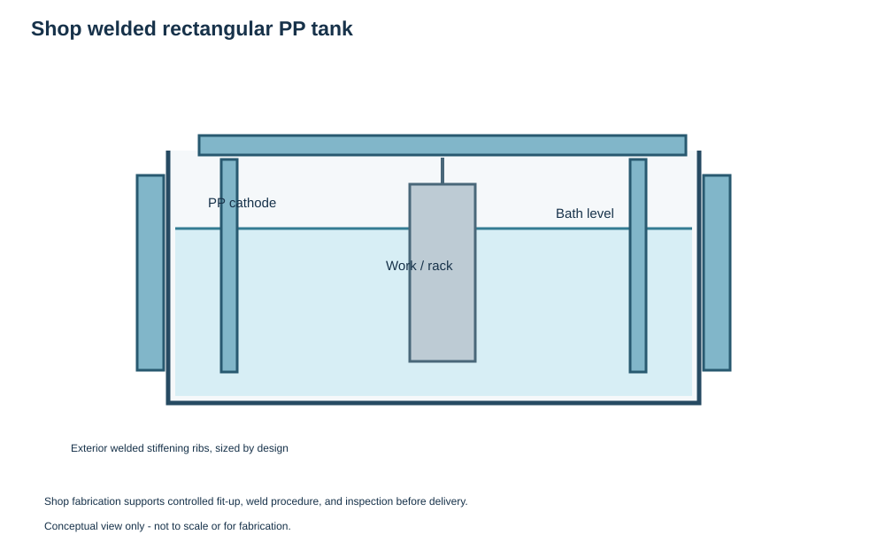
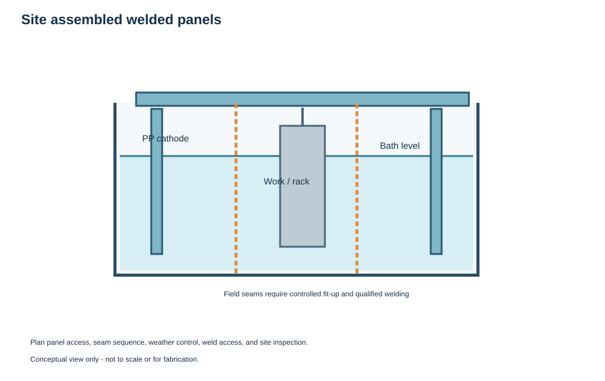
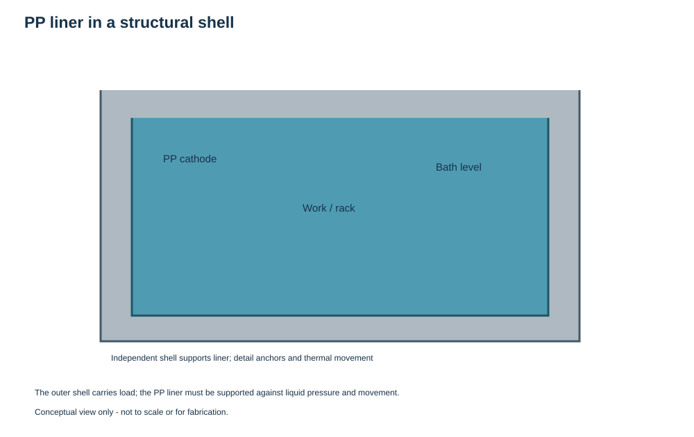
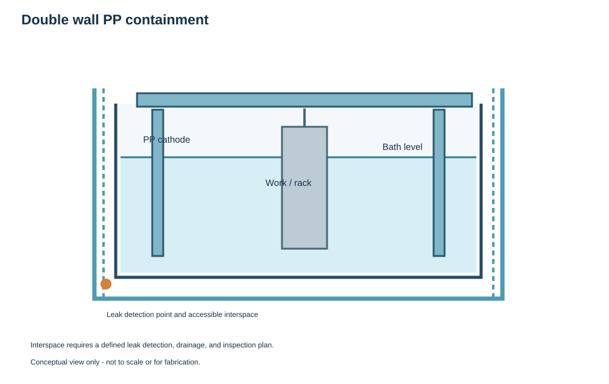
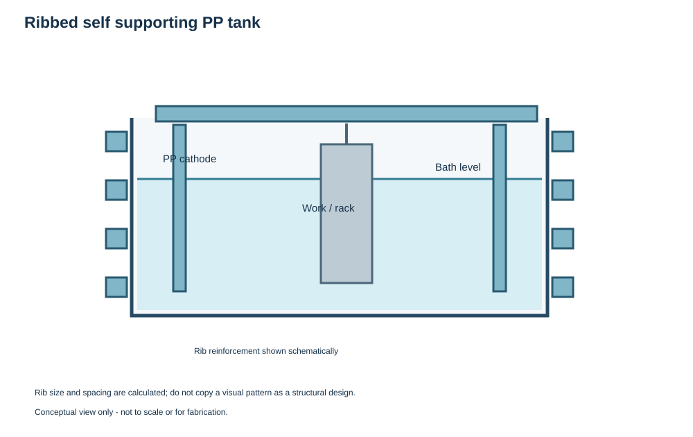
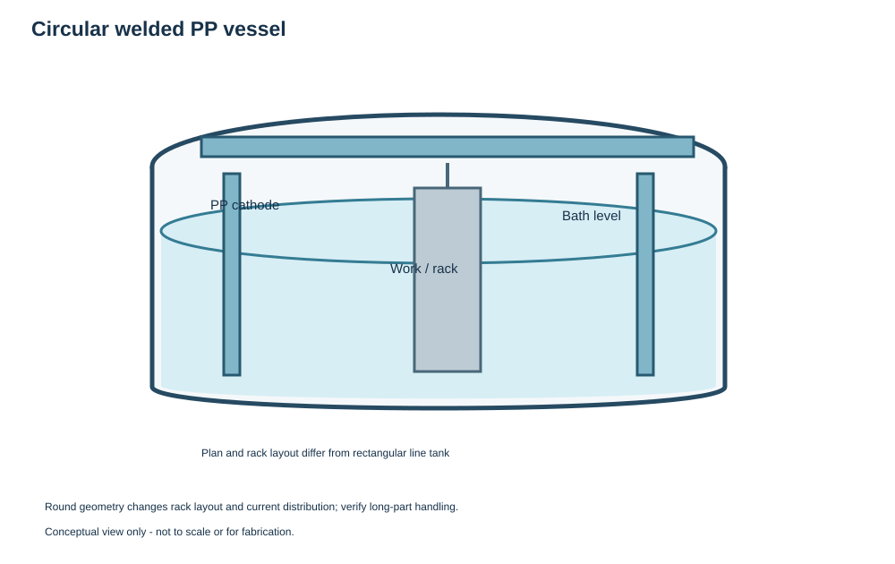
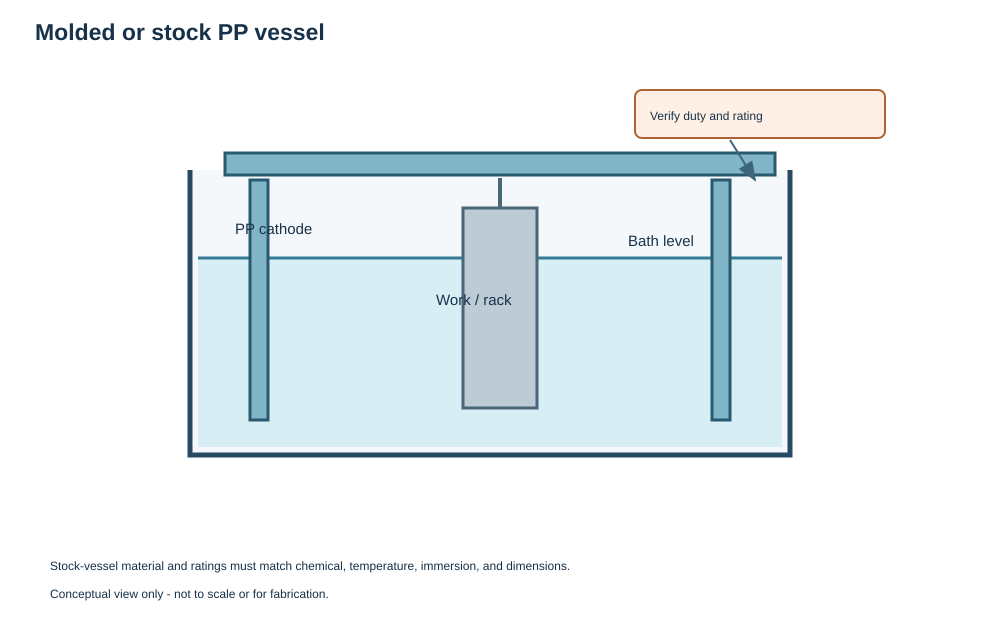

# PP tank construction architecture gallery

Each folder contains an original conceptual setup diagram and an explanation of the build route. Images are not to scale and do not specify dimensions, wall thickness, rib spacing, weld size, reinforcement, or support loads.

## Shop welded rectangular PP tank

Custom welded sheet construction, usually the strongest starting fit for a long anodizing rack.

## Site assembled panels

Use when transportation limits prevent a one-piece tank from reaching the process area.

## PP liner in structural shell

The structural shell supports the vessel; the PP lining forms the wetted chemical barrier.

## Double wall containment

Secondary containment with a designed and inspectable interspace.

## Ribbed self-supporting PP tank

External ribs or frame control wall deflection when engineered for the actual load.

## Circular welded tank

Possible for storage or tailored process layouts; often unsuitable for long extrusion racks.

## Molded or stock vessel

Convenient for small/standard duties only when product ratings and geometry are appropriate.
