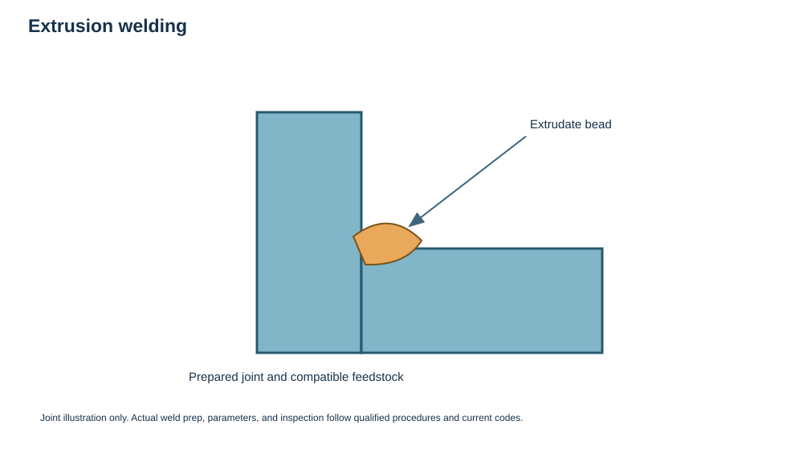

# Extrusion welding

An extrusion welder delivers compatible molten polymer into a prepared joint while hot gas preheats the base material. It is widely used in fabricated thermoplastic tanks, though the exact joint design and pass sequence depend on the approved procedure.

**Use:** structural panel joints, corners, reinforcement, and details as specified by the tank design.

**Control:** verify resin compatibility, surface preparation, welding sequence, equipment condition, operator qualification, and inspection/repair records. Follow the current applicable welding code and written procedure; no process settings are specified here.
