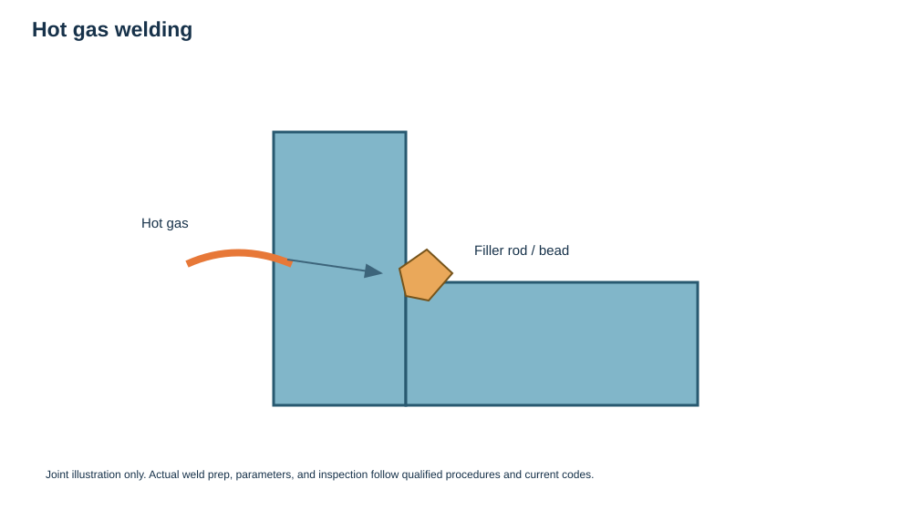

# Hot gas welding

Hot gas softens prepared PP edges and a compatible filler rod forms the seam. It can suit local seams and details where access and material thickness are appropriate.

**Use:** defined joints and attachments in a qualified tank fabrication procedure.

**Control:** joint preparation, cleanliness, filler grade, gas temperature/flow, travel speed, and operator skill affect the result. Qualification and inspection are required for structural containment seams. The schematic is not a procedure.
