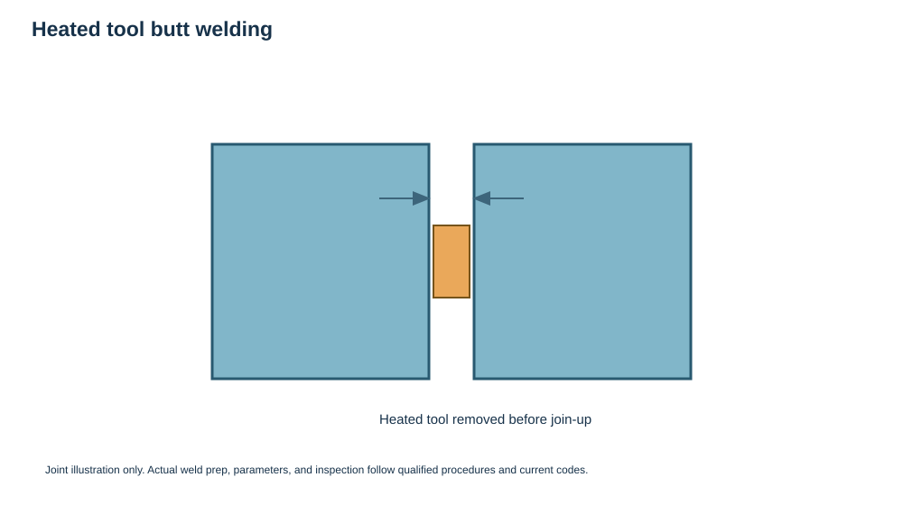

# Heated-tool butt welding

Prepared panel edges are heated against a controlled tool, then joined under a procedure that controls alignment, pressure, and cooling. It is used for edge-to-edge panel joining where equipment and geometry permit.

**Use:** shop or site panel seams with a suitably sized machine and qualified procedure.

**Control:** check alignment, end preparation, machine calibration, heating and joining sequence, cooling, bead acceptance, and traceability. Do not transfer pipe fusion values to plate welding without an approved procedure.
