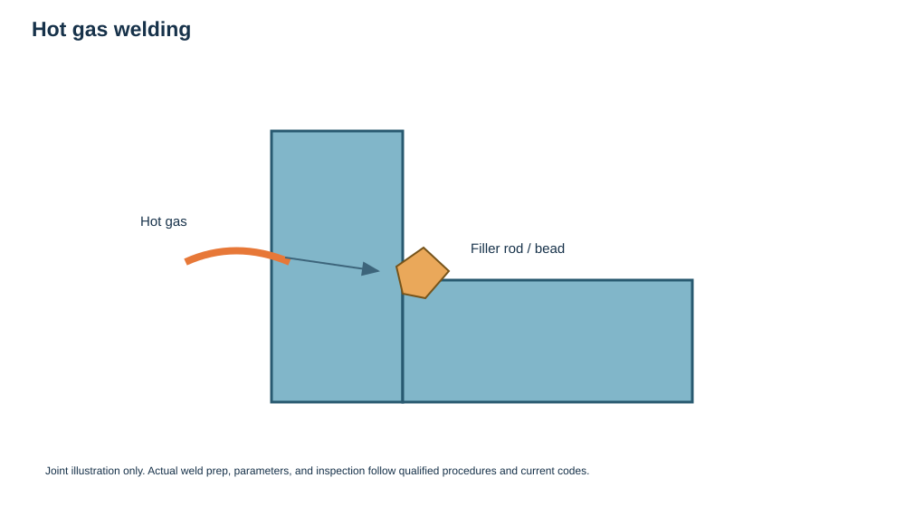
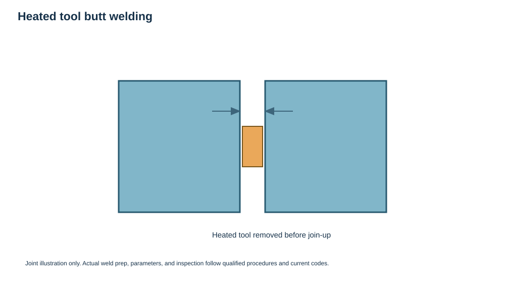

# PP tank welding process gallery

Weld procedures depend on the PP grade, sheet thickness, joint type, access, and applicable standard. These diagrams explain general joint concepts; they are not welding parameter sheets.

## Extrusion welding

Commonly used for structural seams and details in fabricated tanks. Follow qualified joint preparation and procedure.

## Hot-gas welding

Useful for local seams/details where geometry and thickness are suitable. Operator skill and preparation are critical.

## Heated-tool butt welding

Controlled edge-to-edge joining of compatible panels using an approved machine procedure.
