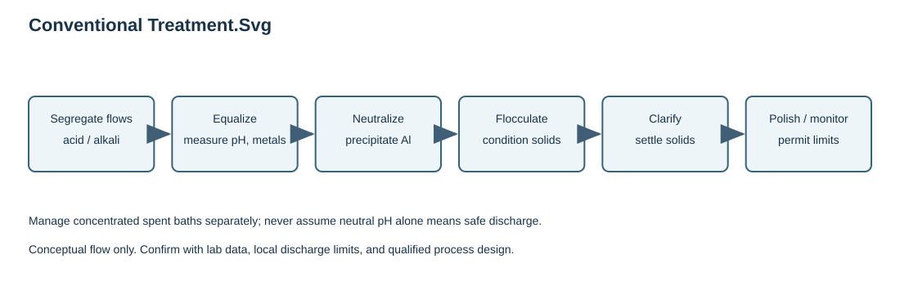

# Aluminum finishing wastewater options

This folder summarizes three technology groups for study. They can be combined, but the right train depends on stream segregation, flow, contaminant loading, discharge route, and sludge handling.

| Topic | Folder | Core question |
| --- | --- | --- |
| Neutralization and metal precipitation | [Conventional precipitation](conventional-precipitation/README.md) | Can the plant reliably meet pH and metal limits while producing manageable sludge? |
| Solids thickening and dewatering | [Sludge dewatering](sludge-dewatering/README.md) | Which conditioning and separation method gives a manageable cake and filtrate? |
| Acid and rinse recovery | [Acid recovery](acid-recovery/README.md) | Is segregated acid recovery and rinse reuse technically and economically suitable? |

All flows are conceptual. Get representative laboratory analyses, conduct jar/dewatering or pilot tests, and verify local permit limits before selecting equipment or operating conditions.
