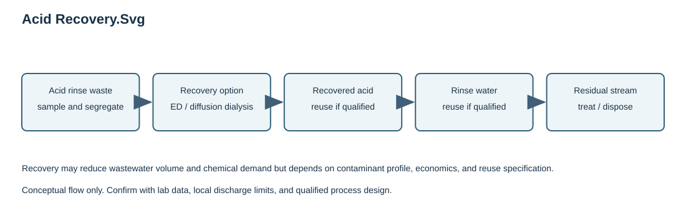

# Acid recovery and rinse reuse

Acid recovery can be considered for suitable segregated rinse or spent streams. Published aluminum-finishing studies investigate electrodialysis, while other work examines membrane distillation after precipitation for acidic anodizing wastewater. These are candidate technologies, not universal replacements for treatment.

Assess feed variability, metals and organics, recovery purity, energy and chemical use, membrane fouling, concentrate disposal, reuse specification, and economics. Bench or pilot testing is needed before design. Keep any residual concentrate in the waste-management plan.

**References:** [Electrodialysis for nitric-acid recovery](https://www.deswater.com/DWT_articles/vol_172_papers/172_2019_199.pdf); [precipitation and membrane distillation for acidic anodizing wastewater](https://doi.org/10.1016/j.jece.2022.108036).
