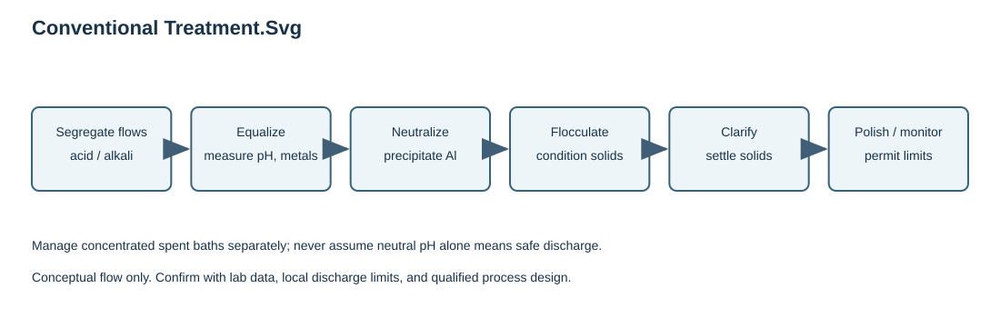

# Conventional precipitation and clarification

Published studies of aluminum-finishing wastewater describe treatment by neutralization and aluminum precipitation, polymer conditioning, and gravity clarification. Actual optimum pH and reagent dose depend on the wastewater composition and should be found by jar tests or pilot trials.

## Typical design questions

- Segregate concentrated spent baths, acidic/alkaline streams, and rinse water where practical.
- Characterize flow, pH, dissolved and total metals, sulfate, suspended solids, organics, and any process-specific contaminants.
- Determine precipitation and flocculation conditions with representative samples.
- Plan clarifier capacity, final pH control, filtration if needed, and compliant monitoring.
- Manage sludge and filtrate return as part of the overall mass balance.

**Reference:** Saunders, Sezgin, and Kutz, [Treatment of Aluminum-Finishing Wastewaters and Sludges](https://p2infohouse.org/ref/27/26524.pdf). The study is historical; confirm current site requirements and technology performance.
