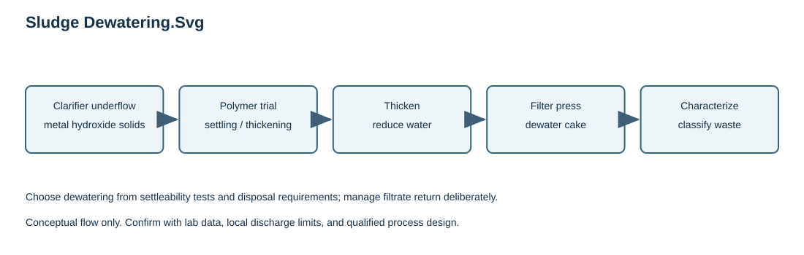

# Sludge thickening and dewatering

Aluminum hydroxide sludge can be difficult to settle and dewater. The cited aluminum-finishing study discusses polymer conditioning, thickening, gravity draining, and filtration. Select equipment only after settling and dewatering tests with actual plant sludge.

Compare gravity thickening, filter press, vacuum filtration, centrifuge, or drying beds against solids capture, cake dryness, throughput, operator skill, footprint, and disposal route. Characterize the cake and filtrate; do not assume the sludge is nonhazardous based only on its appearance.
